# Alignment・Overlay の Wafer 面内傾向に対する経時変化・異常検知手法の比較検証

―― M3S では見えない面内形状の異常を、どの監視手法で、どの条件なら見つけられるか ――

- 作成日：2026年10月13日
- 対象：半導体リソグラフィー工程の Alignment・Overlay 計測の監視（模擬データによる比較検証）
- 再現方法：`.venv/bin/python main.py --config configs/default.yaml --workers 6`（README 参照）

> 本報告の数値はすべて乱数で作った模擬データによるシミュレーションの結果です。実データ・社内データは使っていません。
> 本文では、シミュレーションで得た事実を **【結果】**、それをもとにした解釈や推測を **【考察】** と書き分けます。
> 表と本文の数値はすべて集計 CSV（`results/metrics/`）から自動で埋め込んでいます。

## 要旨

半導体リソグラフィー工程の Alignment・Overlay 計測を対象に、Wafer 面内傾向の異常検知と経時変化監視の手法を、従来の M3S（|平均| + 3σ）管理と比べた。
Zernike 多項式（動径次数 7 まで）で正常な面内傾向を作り、Wafer 間の変動・AR(1) の時系列変動・Shot と Mark の計測誤差を加えた模擬データに、
10種類の単一 Wafer の異常（B1〜B10）と4種類の経時変化（Step・Ramp・非線形 Drift・周期変動）× 6種類の面内成分を入れた。
8つの監視手法（M3S、多項式係数 SPC、Mahalanobis 距離、PCA T²、PCA SPE、GPR 残差、EWMA、CUSUM）と OR 統合を、同じ誤報率（FPR・ARL₀）にそろえ、同じデータで比べた。

【主な結果】
- M3S の検出率が 10% 未満だった7種類の形状異常では、計測値の PCA T²（寄与率 99%）の平均検出率が 52.0%（M3S は 13.5%）。
  平均と標準偏差が同じ滑らかな形の変化（B10）は M3S では原理的に検出できず（検出率 1.7%＝異常を入れる前の同じ Wafer の誤報の割合）、Mahalanobis 距離（4次）は 8σ_dir で 90.4% 検出した。
- 有効な手法は異常の種類で3群に分かれた：正常な大きい変動と同じ向きの滑らかな異常は M3S、係数の組み合わせの異常は Mahalanobis、局所・単一 Shot・高次は PCA T²・SPE・GPR 残差。
  1 Wafer の異常では、M3S・Mahalanobis・PCA T²・SPE・GPR 残差の5指標の OR 統合（統合後の誤報率で校正）が最も高い平均検出率（56.7%、単独の最良は 49.9%）を示した。
- 経時変化は、計測値を EWMA（λ = 0.05）で平滑化してから PCA T² や Mahalanobis 距離を当てる方法（MEWMA）が最も早く（平均 RMST 95.7 枚、M3S は 117.4 枚）、
  局所的な変化には PCA SPE の EWMA が特に早かった。
- 計測点を 25% に減らす・ノイズを3倍にすると、局所的・単一 Shot の異常の検出率が大きく下がった（単一 Shot の異常の PCA T² の検出率：0.82 → 25% で 0.18、ノイズ3倍で 0.52）。配置の最適化の効果は小さかった。
- APC 補正後の Overlay 残差だけを監視すると、補正で除去できる異常とそのドリフトは見えなくなり（検出率が誤報率並み）、補正係数か補正前 Alignment の監視が必要だった。

【結論】単一の手法では不十分で、1 Wafer の判定（M3S・Mahalanobis・PCA T²・SPE・GPR 残差の OR 統合）、経時変化の監視（MEWMA と SPE の EWMA）、
APC の下での補正係数と残差の併用監視、を組み合わせることを推奨する。

---

# 第1章 緒言

## 1.1 背景

露光工程の重ね合わせ（Overlay）と Wafer Alignment の計測値には、Wafer 面内に広がる系統的な傾向（倍率・回転・高次の歪みなど）が含まれる。
近年は線形の6パラメータ補正から高次の補正へ移り [adel2007; pike2012]、面内傾向の形そのものが品質に効くようになった。
一方、日常の工程管理では、計測値の |平均| + 3σ（M3S）を Wafer ごとに管理する方法が今も広く使われている [montgomery2001]。

## 1.2 M3S 管理の限界

M3S は計測値の「平均」と「ばらつき」の2つの集計値だけを見る。そのため次の2つの弱点がある。

1. **形の情報を捨てる**：同じ平均・標準偏差でも、ばらつきが面内のどこにどう並んでいるかは区別できない。
   極端な例として、計測値の位置を入れ替えただけの Wafer は M3S が厳密に同じになる（第5章）。
2. **正常なばらつきに埋もれる**：倍率や回転のような大きな正常変動があると、局所的な変形や1 Shot のずれは
   M3S の値をほとんど変えない。

## 1.3 本研究の目的

本研究では、模擬データで次の6つの問い（RQ）に定量的に答え、異常の種類・変化の速さ・計測条件に応じて
監視手法を選ぶための指針をつくる。

- **RQ1** M3S では見逃す Wafer 面内形状異常に対して、どの監視手法が最も有効か。
- **RQ2** 微小な Wafer 面内傾向の経時変化を最も早く検知できる手法は何か。
- **RQ3** 異常パターンによって有効な監視手法はどの程度異なるか。
- **RQ4** 計測点数や計測ノイズによって監視性能はどの程度低下するか。
- **RQ5** APC 補正後の Overlay のみを監視した場合、どのような異常を見逃すか。
- **RQ6** 単一の監視手法で十分か。それとも複数の監視手法を組み合わせる必要があるか。

比較では、すべての手法を **同じ正常時の誤報率**（1 Wafer の検知は FPR、時系列の検知は ARL₀）にそろえ、
**同じ模擬データ**（Common Random Numbers）を入力する。M3S を必ずベースラインとして含める。

---

# 第2章 Wafer 面内傾向と異常検知

## 2.1 Alignment と Overlay の面内傾向

Alignment 計測は露光前に Wafer 上のマーク位置を測り、Wafer 全体の変形（Grid の歪み）を推定して露光位置を補正する。
Overlay 計測は露光後に上下の層のずれを測る。両者は**別の計測（別の情報源）**であり、同じ面内傾向を別の点・別の誤差で見ている。
本研究では、計測誤差を含まない「潜在的な面内傾向」を真値として持ち、Alignment と Overlay はそれを別々の計測点と誤差で測るとした。

## 2.2 経時変化と突発異常の違い

| | 突発的な異常（単一 Wafer の異常） | 継続的な経時変化 |
|---|---|---|
| 例 | チャックの異物、1 Shot の露光不良、計測の外れ値 | レンズ発熱、チャックの汚れの蓄積、装置の調整ずれ |
| 現れ方 | 1 枚だけ大きく形が変わる | 小さな変化が続く（Step・Ramp・飽和・周期） |
| 評価指標 | 誤報率 FPR をそろえたときの検出率、ROC-AUC・PR-AUC | ARL₀ をそろえたときの検出遅延（打ち切りを考慮） |
| 向く手法 | 各 Wafer を独立に判定（Shewhart 型） | 過去を蓄積する EWMA・CUSUM |

本研究では両者を混同しないよう、評価を Phase 1（1 Wafer）と Phase 2（時系列）に分けた。

## 2.3 異常パターンの分類

単一 Wafer の異常は10種類（B1〜B10）、経時変化は4種類の時間変化（A1〜A4）× 6種類の面内成分とした。

| パターン | σ_dir [nm]（ベクトルのノルム） | κ（平均） | RMS 1σ [nm] | RMS 4σ [nm] | RMS 16σ [nm] |
| :--- | ---: | ---: | ---: | ---: | ---: |
| B1 Radial方向の異常 | 55.47 | 1.24 | 3.12 | 12.48 | 49.93 |
| B2 Tangential方向の異常 | 55.37 | 1.42 | 3.11 | 12.46 | 49.84 |
| B3 局所的な変形 | 23.57 | 9.28 | 1.33 | 5.32 | 21.27 |
| B4 左右・上下非対称 | 46.05 | 1.66 | 2.59 | 10.36 | 41.46 |
| B5 高次Zernike成分異常 | 11.52 | 1.17 | 0.65 | 2.60 | 10.38 |
| B6 複数係数の異常な組み合わせ | 19.85 | 1.14 | 1.12 | 4.47 | 17.86 |
| B7 監視モデル次数で表現できない異常 | 6.27 | 5.02 | 0.36 | 1.45 | 5.79 |
| B8 Scan Up/Down依存異常 | 1.97 | 1.43 | 0.11 | 0.44 | 1.77 |
| B9 単一Shot異常 | 10.30 | 6.88 | 0.59 | 2.34 | 9.38 |
| B10 平均・分散が変わらない面内形状異常 | 18.80 | 1.26 | 1.04 | 4.43 | 11.42 |

σ_dir は「その異常の向きに正常な計測値を射影したときの標準偏差」で、異常の大きさの単位（第3.5節）。
κ ≥ 1 は相関構造の効き方の目安で、κ が大きい形ほど、正常なばらつきの相関を使う手法で見つけやすい。

---

# 第3章 シミュレーション方法

## 3.1 Wafer モデル

- 直径 300 mm、Wafer 中心を原点、単位 mm。外周除外 3 mm（有効半径 147 mm、r < 147 の点だけを使う）。
- Shot 26 × 33 mm の矩形格子（Wafer 中心に Shot 中心）。外周の部分 Shot も使う設定で 97 Shot。
- Alignment は 1 Shot 4 マーク（Shot 中心から (±11, ±14.5) mm）、全点で 316 点。Overlay の検証点は Shot 中心と内側4点の 5 点。
- Scan 方向は露光順（上の行から蛇行）で Up・Down を交互に割り当てた。
- 座標は x/150, y/150 で正規化して Zernike と多項式に使う。

## 3.2 Zernike 多項式

正常な面内傾向は、X・Y それぞれ動径次数 7 までの Zernike 多項式（36項）で表す。

$$f_x(x,y)=\sum_{k=1}^{36} a_k Z_k(x,y),\qquad f_y(x,y)=\sum_{k=1}^{36} b_k Z_k(x,y)$$

- Z_k は単位円板で RMS 正規化（円板上の平均で直交・ノルム1）。係数は円板上の RMS [nm] を表す [noll1976]。
- 係数の並びは Fringe 番号（標準の番号がない n ≤ 7 の6項は同じ並べ方を延長した番号）。Noll 番号との対応も出力できる。
- 係数の標準偏差は次数 n = 0〜7 で 3.0, 2.5, 1.5, 1.0, 0.7, 0.5, 0.35, 0.25 nm（高次ほど小さい、仮定）。
- 正常時の平均（工程の指紋）として低次の11項に値を入れた（仮定）。
- 物理的に結び付く係数に相関を入れた：等方倍率（X の x 項と Y の y 項、+0.8）、回転（X の y 項と Y の x 項、−0.8）、3次の放射状歪み（+0.7）。

## 3.3 時系列生成

正常工程にも時系列の変動を入れた。

$$\boldsymbol\beta_t-\boldsymbol\mu=\rho(\boldsymbol\beta_{t-1}-\boldsymbol\mu)+\boldsymbol\eta_t,\qquad \boldsymbol\eta_t\sim N(0,(1-\rho^2)\Sigma_\beta)$$

イノベーションの共分散を (1 − ρ²)Σ_β にすると、定常共分散は ρ によらず Σ_β になる。基準は ρ = 0.7、Phase 2 で ρ = 0, 0.3, 0.7, 0.95 を比べた。
学習データは時系列順の正常系列（3,000 枚）で、校正・評価のデータとは別の乱数列から作った。

## 3.4 計測ノイズ

計測値 = 潜在値 + Shot 共通誤差（同じ Shot の全マークに同じ値、σ = 0.5 nm）+ Mark 独立誤差（σ = 1.0 nm）。
XY 間の誤差相関も設定できる（基準は 0）。Phase 3 で倍率 0.5・1・2・3 を比べた。
空間自己相関（相関距離をもつ空間相関ノイズ）は本研究の対象外とし、Shot 共通誤差は階層的な計測誤差として扱った。

## 3.5 異常注入方法

**大きさの基準**：異常の形 v（全点マップ上の 2N 次元ベクトル、N = 316）を単位方向 d = v/‖v‖ にし、

$$\sigma_{\mathrm{dir}}=\sqrt{\mathbf d^\top\Sigma_z\mathbf d}\qquad(\Sigma_z：正常な計測値の共分散。潜在値＋計測誤差、解析的に計算)$$

を求め、振幅 a の異常を a·σ_dir·d とした（仕様の「各異常方向への射影の正常標準偏差」）。
異常の形は座標の関数なので、Phase 3 で点数やノイズを変えても**同じ物理的な大きさ**の異常を測ることになる。
1 Wafer の異常は 1, 2, 4, 8, 16σ_dir、経時変化は 0.25, 0.5, 1, 2, 3σ_dir とした。

**参考の理論値**：方向を知っている検定の検出率も示す。射影の片側管理図 Φ(a − z_α) は定義上すべてのパターンで同じになり、
白色化した尤度比検定は Φ(aκ − z_α) になる（κ = sqrt((dᵀΣd)(dᵀΣ⁻¹d))）。実際の手法は向きを知らないので、これらは上限の目安である。

**B10（平均・標準偏差が変わらない異常）**は2通りで作った。
- 方法1：計測値の位置の入れ替え（180°回転・左右反転・上下反転・無作為な入れ替え）。値の集合は同じなので M3S は厳密に同じ。
- 方法2：計測誤差には手を付けず、軸ごとに Δ = t·u − s·c_s（u：n = 2〜4 の Zernike の形、c_s：真の潜在値を中心化したもの）とし、
  中心化した計測値のノルムが変わらないように s を決める。「正常な指紋の一部が異常な形に置き換わり、ばらつきの総量は同じ」という滑らかな変形である。

| 振幅 [σ_dir] | 平均の差の最大 [nm] | 標準偏差の差の最大 [nm] | M3S の差の最大 [nm] | 変化の RMS [nm] | 頭打ちの割合 |
| ---: | ---: | ---: | ---: | ---: | ---: |
| 1.00 | 2.66e-15 | 1.78e-15 | 1.07e-14 | 0.74 | 0.00 |
| 2.00 | 1.78e-15 | 3.55e-15 | 1.07e-14 | 1.49 | 0.00 |
| 4.00 | 1.83e-15 | 2.66e-15 | 1.07e-14 | 3.13 | 0.03 |
| 8.00 | 3.55e-15 | 7.99e-15 | 2.49e-14 | 6.59 | 0.78 |
| 16.00 | 3.55e-15 | 1.15e-14 | 3.55e-14 | 8.08 | 1.00 |

【結果】平均・標準偏差・M3S の差は最大でも 3.6e-14 nm（浮動小数点の誤差の範囲）で、自動テストでも確認した。
振幅 8σ_dir では 78%、16σ_dir では 100% の Wafer で、正常なばらつきの総量を超えられないため大きさが頭打ちになった。

**経時変化**は 300 枚の系列の 101 枚目から入れた（A1 Step、A2 線形 Ramp：100 枚後に振幅 a に達しその後も増える、
A3 非線形 Drift：1 − exp(−t/50)、A4 周期変動：周期 50 枚の正弦波）。面内成分は低次 Zernike・高次 Zernike・Radial・Tangential・非対称・局所の6種類。

---

# 第4章 監視手法

すべての手法は正常データだけで学習し、管理限界は正常データの経験分布から決めた（第4.9節）。

## 4.1 M1：M3S

X・Y それぞれ M3S = |μ| + 3σ（σ は不偏標準偏差 ddof = 1 で統一）。XY 統合判定は、X・Y の M3S を正常時の平均・標準偏差で
標準化して大きい方をスコアにし（OR 判定）、統合後の誤報率で管理限界を決めた。

## 4.2 M2：多項式係数 SPC

X・Y それぞれ d 次（3・4・5次）の多項式 f(x,y) = Σ_{i+j≤d} c_ij x^i y^j を最小二乗で当てはめ、係数ごとに標準化した z_j の
管理図を OR でまとめる。スコアは max_j |z_j| で、全体の誤報率（どれか1つでも超える確率）が目標値になるよう限界を決めた。

## 4.3 M3：Mahalanobis 距離

係数ベクトル β の D² = (β − μ)ᵀ Σ⁻¹ (β − μ)。Σ は Ledoit–Wolf の縮小推定 [ledoit2004] で安定化した（それでも正定値でなければ対角に小さな値を足す）。

## 4.4 M4：PCA Hotelling T²、M5：PCA SPE

入力は「固定した計測点の XY 計測値（632 次元）」と「5次の係数ベクトル（42 次元）」の2通り。累積寄与率 90・95・99% で主成分数を決め、
T² = Σ t_k²/λ_k（主成分の部分空間の中の異常）と SPE = ‖z − ẑ‖²（部分空間から外れた異常）を求めた [jackson1979; macgregor1995]。

| 手法 | 系統 | 学習で決まった値 |
| :--- | :--- | :--- |
| M3S_XY | M1 | — |
| M3S_X | M1 | — |
| M3S_Y | M1 | — |
| SPC_d3 | M2 | 10 項 × XY、条件数 15 |
| MD_d3 | M3 | 係数 20 個、縮小の強さ 0.0056、条件数 15 |
| SPC_d4 | M2 | 15 項 × XY、条件数 45 |
| MD_d4 | M3 | 係数 30 個、縮小の強さ 0.0058、条件数 45 |
| SPC_d5 | M2 | 21 項 × XY、条件数 131 |
| MD_d5 | M3 | 係数 42 個、縮小の強さ 0.0048、条件数 131 |
| T2_raw_q90 | M4 | 主成分 29 個（累積寄与率 90.1%、入力 632 次元） |
| SPE_raw_q90 | M5 | 主成分 29 個（累積寄与率 90.1%、入力 632 次元） |
| T2_raw_q95 | M4 | 主成分 47 個（累積寄与率 95.1%、入力 632 次元） |
| SPE_raw_q95 | M5 | 主成分 47 個（累積寄与率 95.1%、入力 632 次元） |
| T2_raw_q99 | M4 | 主成分 313 個（累積寄与率 99.0%、入力 632 次元） |
| SPE_raw_q99 | M5 | 主成分 313 個（累積寄与率 99.0%、入力 632 次元） |
| T2_coef5_q90 | M4 | 主成分 15 個（累積寄与率 91.1%、入力 42 次元） |
| SPE_coef5_q90 | M5 | 主成分 15 個（累積寄与率 91.1%、入力 42 次元） |
| T2_coef5_q95 | M4 | 主成分 20 個（累積寄与率 95.6%、入力 42 次元） |
| SPE_coef5_q95 | M5 | 主成分 20 個（累積寄与率 95.6%、入力 42 次元） |
| T2_coef5_q99 | M4 | 主成分 30 個（累積寄与率 99.1%、入力 42 次元） |
| SPE_coef5_q99 | M5 | 主成分 30 個（累積寄与率 99.1%、入力 42 次元） |
| GPR_rbf_residual | M6 | X：σ_f 13.8 nm・ℓ 63 mm・σ_shot 0.50・σ_mark 1.04 nm |
| GPR_rbf_full | M6 | X：σ_f 13.8 nm・ℓ 63 mm・σ_shot 0.50・σ_mark 1.04 nm |
| GPR_matern52_residual | M6 | X：σ_f 19.9 nm・ℓ 133 mm・σ_shot 0.51・σ_mark 1.00 nm |
| GPR_matern52_full | M6 | X：σ_f 19.9 nm・ℓ 133 mm・σ_shot 0.51・σ_mark 1.00 nm |

## 4.5 M6：GPR 残差

軸ごとに z_w(s) = μ(s) + u_w(s) + ε_w(s) とした [rasmussen2006]。μ(s) は正常 Wafer 共通の平均面内傾向（学習データの点ごとの平均を GPR で平滑化）、
u_w(s) は Wafer ごとの個体差（RBF または Matérn 5/2 の GP）、ε は Shot 共通＋Mark 独立の階層的な計測誤差である。
超パラメータは学習 Wafer 全体の周辺尤度の最大化で決めた（推定した計測誤差は X で σ_shot = 0.50、σ_mark = 1.04 nm で、真値 0.5・1.0 nm とほぼ一致）。
統計量は2通り：個体差の事後平均を除いた残差 rᵀK_n⁻¹r（residual）と、GP の下での Mahalanobis 距離 dᵀK⁻¹d（full）。
計測点が固定なので行列を先に作り、1 Wafer の計算を dᵀAd だけにした（固定グリッドによる軽量化）。

**PCA-SPE と GPR 残差の違い**：PCA-SPE は「正常データの共分散から学んだ k 次元の部分空間」の外の成分を見る（データ駆動、
部分空間の大きさは寄与率で決まる）。GPR 残差は「滑らかな関数（カーネル）で表せる成分」を Wafer ごとに取り除いた残りを見る（座標と滑らかさの仮定に基づく）。
そのため GPR 残差は、正常データに一度も現れていない形でも滑らかなら個体差として吸収し、急な変化（Shot・Mark 単位、Scan 依存）にだけ反応する。

## 4.6 M7：EWMA

S_t = λx_t + (1 − λ)S_{t−1}（λ = 0.05, 0.1, 0.2, 0.4）[roberts1959; lucas1990]。計測値そのものを EWMA で平滑化し、平滑化した地図に 1 Wafer の統計量を当てた。
係数・PCA スコアは計測値の線形関数なので、これは「係数ごとの EWMA」や「多変量 EWMA（MEWMA）」[lowry1992] と同じになる。
M3S と Mahalanobis 距離そのものはスカラーの EWMA も比べた。

## 4.7 M8：CUSUM

C⁺_t = max(0, C⁺_{t−1} + z_t − k)、C⁻_t = max(0, C⁻_{t−1} − z_t − k) [page1954]。係数は係数ごとの両側 CUSUM（OR）、
白色化したベクトル（Mahalanobis・PCA）は多変量 CUSUM [crosier1988]、スカラーのスコアは上側 CUSUM とした。

## 4.8 時系列監視での注意

自己相関のある工程では、計測値をそのまま EWMA・CUSUM にかけると正常時の統計量もゆっくり動く。
ρ の比較（第6.7節）では、AR(1) の残差 z̃_t = (z_t − c) − φ(z_{t−1} − c) を監視する「特殊原因管理図」[alwan1988] も比べた。

## 4.9 管理限界の設定と誤報率の統一

- 1 Wafer の検知：校正用の正常データ（50,000 枚）のスコアの上側 α 分位点を限界とし、別の評価用正常データ（50,000 枚）で実際の FPR を確かめた（α = 5%・1%・0.1%）。
- 複数指標の OR 判定：各指標を校正データの経験分布関数で [0, 1] に変換し、最大値を統合スコアとして同じように校正した。
- 時系列の検知：正常系列（長さ 3,000 枚 × 1,000 本）の連長から、ARL₀ = 370 になる限界を二分探索で決め、独立な正常系列（1,000 本）で ARL₀ を確かめた。
- 理論上の限界（χ²・F 分布・Box の近似 [box1954]）は比較用に計算した。

| 手法 | 目標 FPR | 経験的な限界の FPR | 理論上の限界の FPR |
| :--- | :--- | :--- | :--- |
| M3S_XY | 5.0% | 4.92%（4.73%〜5.11%） | — |
| M3S_XY | 1.0% | 0.99%（0.90%〜1.08%） | — |
| M3S_XY | 0.1% | 0.10%（0.08%〜0.13%） | — |
| SPC_d4 | 5.0% | 5.03%（4.84%〜5.23%） | 4.30% |
| SPC_d4 | 1.0% | 1.03%（0.94%〜1.12%） | 0.95% |
| SPC_d4 | 0.1% | 0.12%（0.09%〜0.15%） | 0.11% |
| MD_d5 | 5.0% | 4.88%（4.70%〜5.07%） | 3.96% |
| MD_d5 | 1.0% | 0.99%（0.90%〜1.08%） | 0.69% |
| MD_d5 | 0.1% | 0.07%（0.05%〜0.10%） | 0.05% |
| T2_raw_q99 | 5.0% | 4.89%（4.70%〜5.08%） | 0.00% |
| T2_raw_q99 | 1.0% | 1.04%（0.96%〜1.13%） | 0.00% |
| T2_raw_q99 | 0.1% | 0.09%（0.06%〜0.12%） | 0.00% |
| SPE_raw_q99 | 5.0% | 4.95%（4.76%〜5.14%） | 99.97% |
| SPE_raw_q99 | 1.0% | 0.90%（0.82%〜0.98%） | 99.69% |
| SPE_raw_q99 | 0.1% | 0.08%（0.06%〜0.11%） | 97.92% |
| GPR_rbf_full | 5.0% | 4.72%（4.54%〜4.91%） | — |
| GPR_rbf_full | 1.0% | 0.91%（0.83%〜1.00%） | — |
| GPR_rbf_full | 0.1% | 0.08%（0.06%〜0.11%） | — |
| MD_d5\|EWMA-scalar(λ=0.4) | 5.0% | 5.15%（4.96%〜5.35%） | — |
| MD_d5\|EWMA-scalar(λ=0.4) | 1.0% | 1.02%（0.93%〜1.11%） | — |
| MD_d5\|EWMA-scalar(λ=0.4) | 0.1% | 0.09%（0.07%〜0.12%） | — |
| GPR_matern52_residual\|CUSUM(k=1) | 5.0% | 4.93%（4.74%〜5.12%） | — |
| GPR_matern52_residual\|CUSUM(k=1) | 1.0% | 0.91%（0.83%〜1.00%） | — |
| GPR_matern52_residual\|CUSUM(k=1) | 0.1% | 0.10%（0.08%〜0.13%） | — |
| SPE_raw_q90 | 5.0% | 4.98%（4.79%〜5.17%） | 11.52% |
| SPE_raw_q90 | 1.0% | 1.05%（0.96%〜1.14%） | 3.70% |
| SPE_raw_q90 | 0.1% | 0.10%（0.08%〜0.13%） | 0.80% |
| SPE_raw_q95 | 5.0% | 4.91%（4.73%〜5.10%） | 14.77% |
| SPE_raw_q95 | 1.0% | 0.95%（0.87%〜1.04%） | 5.34% |
| SPE_raw_q95 | 0.1% | 0.11%（0.09%〜0.15%） | 1.37% |
| T2_raw_q95 | 5.0% | 5.03%（4.84%〜5.23%） | 5.73% |
| T2_raw_q95 | 1.0% | 1.02%（0.94%〜1.11%） | 1.23% |
| T2_raw_q95 | 0.1% | 0.08%（0.06%〜0.11%） | 0.11% |

【結果】経験的に決めた限界の誤報率（評価データ）は、目標 1% に対して 0.85%〜1.17%、目標 0.1% に対して 0.06%〜0.14% だった
（0.1% の限界は校正データ 50,000 枚の上位 50 件で決まるので、限界そのものにもばらつきがある）。理論上の限界は手法によって大きくずれ、
特に寄与率 99% の SPE（Box の近似）は目標 0.1% に対して 97.9% の誤報率になり、寄与率 99% の T²（F 分布）は逆に 0.00%（限界が高すぎる）だった。
【考察】寄与率を高くとると、残りの成分は計測誤差と区別しにくい小さな固有値ばかりになり、学習データから推定した固有値が実際より小さく出る。
理論式はこの推定誤差を考えないため、限界が低すぎた可能性が高い。経験的な校正が必要な理由の1つである。

---

# 第5章 異常検知性能（Phase 1：1 Wafer の異常）

各パターン・各振幅で 1,000 枚の異常 Wafer を作り、すべての手法に同じ Wafer を入力した（Common Random Numbers）。
M7（EWMA）・M8（CUSUM）は「直前 100 枚の正常 Wafer の流れの中に、異常な Wafer が1枚だけ入ったとき、その Wafer で警報が出るか」で評価した。
以下、特に断らない限り誤報率（FPR）1% での値である。

## 5.1 基本検出率

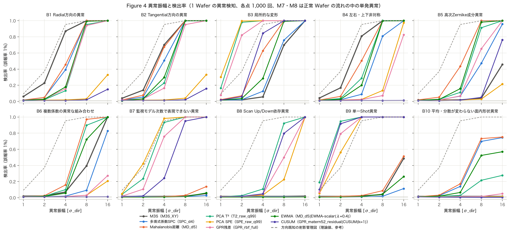

| 系統 | 代表の設定 | 平均検出率（B1〜B10・1〜16σ_dir・FPR 1%） |
| :--- | :--- | ---: |
| M1 M3S | M3S_XY | 0.28 |
| M2 多項式係数SPC | SPC_d4 | 0.27 |
| M3 Mahalanobis距離 | MD_d5 | 0.36 |
| M4 PCA T² | T2_raw_q99 | 0.50 |
| M5 PCA SPE | SPE_raw_q99 | 0.31 |
| M6 GPR残差 | GPR_rbf_full | 0.39 |
| M7 EWMA | MD_d5\|EWMA-scalar(λ=0.4) | 0.30 |
| M8 CUSUM | GPR_matern52_residual\|CUSUM(k=1) | 0.25 |
| OR OR統合 | OR[M3S_XY+MD_d4+T2_raw_q99+SPE_raw_q99+GPR_rbf_full] | 0.57 |

【結果】系統ごとに平均検出率が最も高い設定を代表とした。単独の手法では PCA T²（計測値、寄与率 99%）が 49.9% で最も高く、
GPR 残差 39.3%、Mahalanobis 距離 35.7%、PCA SPE 30.5% が続いた。
ベースラインの M3S は 27.6%、係数 SPC は 26.6% だった。複数指標の OR 統合（統合後の誤報率で校正）では、M3S・Mahalanobis（4次）・PCA T²・SPE・GPR 残差の5指標が 56.7% で全体の最高、
PCA T²・SPE・GPR 残差の3指標（寄与率 95%）は 51.0% だった（5指標の組み合わせは Phase 1 の結果を見て決めたので、少し有利に出ている可能性がある）。
誤報率 5% と 0.1% でも順位はほぼ同じで、PCA T²（99%）は 56.4%（FPR 5%）・44.6%（FPR 0.1%）、
M3S は 36.0%・21.3% だった。

【結果】EWMA・CUSUM は、単発の異常では各 Wafer を独立に判定する方法より弱かった。Mahalanobis 距離（5次）では、そのまま（Shewhart）の
35.7% に対し、D² のスカラー EWMA は λ = 0.4 で 29.5%、λ = 0.05 で 17.7%、係数の多変量 EWMA（MEWMA）は λ = 0.4 で 19.9% だった。
多変量 CUSUM（k = 0.5）は 0.6% で、誤報率と同じ程度にしか反応しなかった。
【考察】EWMA は今の Wafer の重みが λ しかなく、CUSUM は過去の正常な変動が積み上がった状態に1枚分を足すだけなので、
1枚だけの異常は薄まる。単発の異常と継続的な変化は、別の検出器で監視するのがよい（第6章で継続的な変化を比べる）。

## 5.2 M3S では検出できない異常

【結果】振幅 4σ_dir で M3S の検出率が 10% 未満だったのは、B3・B5・B6・B7・B8・B9・B10 の7パターンだった。
この7パターン・全振幅の平均検出率は、5指標の OR 統合 56.2%、PCA T²（99%）52.0%、3指標の OR 統合（T²＋SPE＋GPR）51.0%、GPR 残差 41.2%、
PCA SPE（99%）37.9%、Mahalanobis 28.5% に対し、M3S は 13.5% だった。

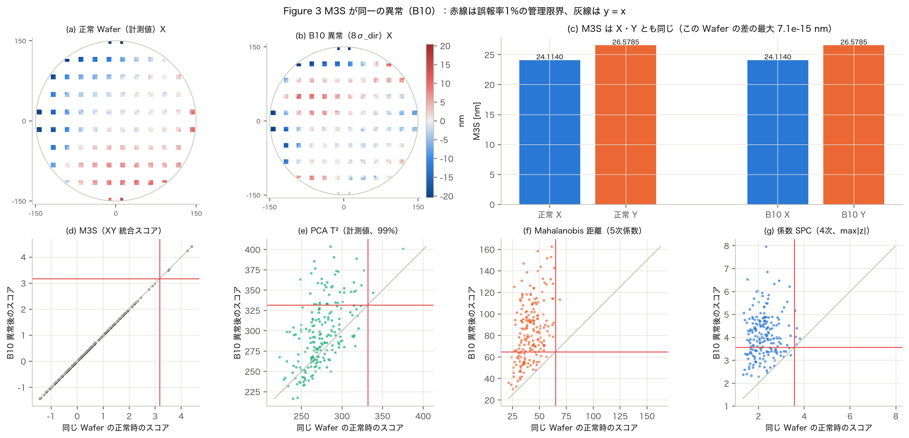

**B10 方法2（滑らかな変形）**
【結果】M3S の検出率は振幅によらず 1.7% で、異常を入れる前の同じ 1,000 枚の誤報の割合とまったく同じだった（M3S は同一なので、識別する手がかりがない）。
係数を使う手法は検出でき、振幅 8σ_dir で Mahalanobis（4次）90.4%・Mahalanobis（5次）73.3%・係数 SPC（4次）69.8% だった。
一方、PCA T²（99%）は 21.6%、PCA SPE（99%）は 1.2%、GPR 残差は 1.5% にとどまった。
【考察】B10 の変化は「滑らかな形」と「正常な指紋」の組み合わせなので、計測誤差の成分（SPE・GPR 残差が見る部分）は変わらない。
係数空間で「形の組み合わせが普段と違う」ことを見る手法だけが反応した。計測値の PCA T²（99%）は 313 個の主成分の大半が計測誤差の方向なので、
係数の異常が薄まったと考えられる。

**B10 方法1（計測値の位置の入れ替え）**

| 入れ替え方 | M3S | 多項式係数SPC | Mahalanobis距離 | PCA T² | PCA SPE | GPR残差 | EWMA | CUSUM | OR統合 |
| :--- | ---: | ---: | ---: | ---: | ---: | ---: | ---: | ---: | ---: |
| 左右反転 | 0.02 | 0.05 | 0.42 | 0.30 | 0.02 | 0.02 | 0.22 | 0.01 | 0.46 |
| 上下反転 | 0.02 | 0.07 | 0.44 | 0.31 | 0.02 | 0.03 | 0.23 | 0.01 | 0.48 |
| 180°回転 | 0.02 | 0.10 | 0.08 | 0.03 | 0.01 | 0.04 | 0.04 | 0.01 | 0.07 |
| 無作為な入れ替え | 0.02 | 0.00 | 0.00 | 1.00 | 1.00 | 1.00 | 0.00 | 1.00 | 1.00 |

【結果】無作為な入れ替えは、PCA T²・SPE・GPR 残差では 100% 検出できたが、Mahalanobis と係数 SPC では 0.0% だった。
左右・上下の反転は Mahalanobis（5次）で 43.0%、180°回転は比べた全ての設定で 16.6% 以下だった。
【考察】無作為に入れ替えると滑らかな形が壊れて多項式の係数が 0 に近づくため、係数を使う手法には「普段より平らな Wafer」に見え、
上側だけの管理限界では見逃す（下側の監視が必要。issues I-022）。180°回転は Zernike の奇数次の方位成分の符号を反転させるだけで、
正常な Wafer の分布がほぼ対称なため、回転した Wafer は正常な Wafer とほとんど区別できない。M3S に限らずどの手法でも原理的に見つけにくい異常である。

## 5.3 異常種類別の得意・不得意

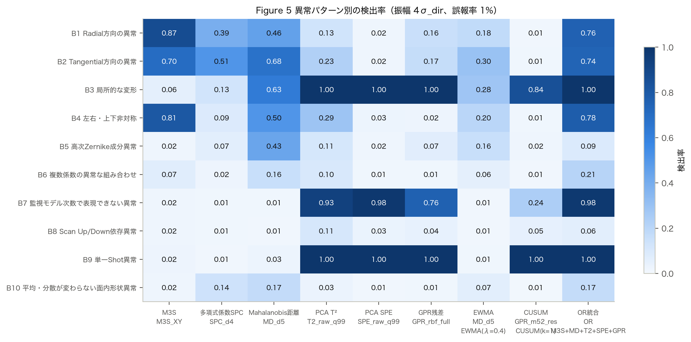

| パターン | M3S | 多項式係数SPC | Mahalanobis距離 | PCA T² | PCA SPE | GPR残差 | EWMA | CUSUM | OR統合 | 理論：射影 | 理論：白色化 |
| :--- | ---: | ---: | ---: | ---: | ---: | ---: | ---: | ---: | ---: | ---: | ---: |
| B1 Radial方向の異常 | 0.87 | 0.39 | 0.46 | 0.13 | 0.02 | 0.16 | 0.18 | 0.01 | 0.76 | 0.95 | 1.00 |
| B2 Tangential方向の異常 | 0.70 | 0.51 | 0.68 | 0.23 | 0.02 | 0.17 | 0.30 | 0.01 | 0.74 | 0.95 | 1.00 |
| B3 局所的な変形 | 0.06 | 0.13 | 0.63 | 1.00 | 1.00 | 1.00 | 0.28 | 0.84 | 1.00 | 0.95 | 1.00 |
| B4 左右・上下非対称 | 0.81 | 0.09 | 0.50 | 0.29 | 0.03 | 0.02 | 0.20 | 0.01 | 0.78 | 0.95 | 1.00 |
| B5 高次Zernike成分異常 | 0.02 | 0.07 | 0.43 | 0.11 | 0.02 | 0.07 | 0.16 | 0.02 | 0.09 | 0.95 | 0.99 |
| B6 複数係数の異常な組み合わせ | 0.07 | 0.02 | 0.16 | 0.10 | 0.01 | 0.01 | 0.06 | 0.01 | 0.21 | 0.95 | 0.99 |
| B7 監視モデル次数で表現できない異常 | 0.02 | 0.01 | 0.01 | 0.93 | 0.98 | 0.76 | 0.01 | 0.24 | 0.98 | 0.95 | 1.00 |
| B8 Scan Up/Down依存異常 | 0.02 | 0.01 | 0.01 | 0.11 | 0.03 | 0.04 | 0.01 | 0.05 | 0.06 | 0.95 | 1.00 |
| B9 単一Shot異常 | 0.02 | 0.01 | 0.03 | 1.00 | 1.00 | 1.00 | 0.01 | 1.00 | 1.00 | 0.95 | 1.00 |
| B10 平均・分散が変わらない面内形状異常 | 0.02 | 0.14 | 0.17 | 0.03 | 0.01 | 0.01 | 0.07 | 0.01 | 0.17 | 0.95 | 1.00 |

（振幅 4σ_dir、FPR 1% の検出率。「理論：射影」は方向を知っている射影の管理図、「理論：白色化」は白色化した尤度比検定の理論値で、上限の目安）

**検出可能な最小異常振幅**（検出率 50% に達する振幅 [σ_dir]、FPR 1%）

| パターン | M3S | 多項式係数SPC | Mahalanobis距離 | PCA T² | PCA SPE | GPR残差 | EWMA | CUSUM | OR統合 |
| :--- | ---: | ---: | ---: | ---: | ---: | ---: | ---: | ---: | ---: |
| B1 | 2.68 | 4.53 | 4.24 | 5.46 | — | 5.42 | 5.26 | — | 3.01 |
| B2 | 3.12 | 3.96 | 3.27 | 5.11 | — | 5.37 | 4.89 | — | 3.07 |
| B3 | 6.46 | 6.02 | 3.41 | 1.33 | 1.22 | 1.48 | 4.94 | 2.95 | 1.29 |
| B4 | 2.87 | 5.94 | 3.97 | 4.92 | 10.81 | 11.86 | 5.19 | — | 2.99 |
| B5 | — | 8.33 | 4.34 | 5.60 | — | 6.68 | 5.33 | 12.39 | 5.73 |
| B6 | 9.02 | 11.75 | 5.35 | 5.66 | — | — | 6.34 | — | 5.17 |
| B7 | — | — | — | 2.60 | 2.20 | 3.04 | — | 5.15 | 2.39 |
| B8 | — | — | — | 5.59 | 10.23 | 8.01 | — | 6.08 | 5.94 |
| B9 | — | — | 15.64 | 1.33 | 1.84 | 1.51 | — | 1.40 | 1.37 |
| B10 | — | 6.26 | 6.00 | — | — | — | 7.72 | — | 5.69 |

（「—」は 16σ_dir でも検出率 50% に届かない）

【結果】得意・不得意は、異常の形と正常なばらつきの関係で3つに分かれた。
1. **正常な変動の大きい滑らかな方向（B1 Radial・B2 Tangential・B4 非対称）**：M3S が最もよく、50% 検出の振幅は 2.7〜3.1σ_dir
   （射影の管理図の理論値 2.33σ_dir に近い）。Mahalanobis（3次）も同程度だった。
2. **係数の組み合わせの異常（B5 高次 Zernike・B6 組み合わせ・B10）**：Mahalanobis と係数の PCA T² が最もよい。係数 SPC は係数どうしの相関を使えないため劣った
   （B6 の 50% 検出振幅：Mahalanobis（5次）5.4、係数 SPC 11.7σ_dir）。
3. **滑らかでない・局所的・高次の異常（B3 局所・B7 表現できない高次・B8 Scan 依存・B9 単一 Shot）**：計測値の PCA T²（99%）・SPE・GPR 残差がよく、
   M3S と係数を使う手法はほとんど検出できなかった。B9 の 50% 検出振幅は PCA T²（99%）1.3、GPR 残差 1.5σ_dir。
   B8（Scan 依存）は最も難しく、PCA T²（99%）でも 5.6σ_dir 必要だった。

【考察】κ が大きい形（B3：9.3、B9：6.9、B7：5.0）は、正常なばらつきの小さい方向（計測誤差だけの方向）に異常が乗るため、
計測値を白色化する手法（主成分の多い T²、SPE、GPR）が理論値に近い感度を出せる。反対に κ ≈ 1 の B1・B2 では、異常の向きが正常な大きい変動と同じなので、
多次元の手法は「次元の多さ」の分だけ不利になり、1次元の M3S が有利になった。

---

# 第6章 経時変化検知性能（Phase 2）

## 6.0 評価の条件

- 土台の手法：ベースラインの M3S、参照用の係数 SPC（4次）、Phase 1 の系統別代表の上位4つ（PCA T²（計測値 99%）・GPR 残差（RBF、full）・Mahalanobis（5次）・PCA SPE（計測値 99%））。
- それぞれ Shewhart（各 Wafer を独立に判定）・EWMA・CUSUM の3方式。λ と k は独立な乱数の予備評価（200 系列）で、平均遅延が最小のものを選んだ
  （計測値の EWMA は4手法とも λ = 0.05、M3S は λ = 0.1、係数 SPC は λ = 0.2。CUSUM は M3S が k = 0.25、GPR が k = 0.5、ほかは k = 1）。
- 本評価は 1 条件 1,000 系列（300 枚、101 枚目から変化）。全ての検出器を正常系列で ARL₀ = 370 に校正し、独立な正常系列で確かめた（付録 C.1：341〜395）。
- 変化点より前に誤報が出た系列は遅延の集計から除いた（条件付き期待遅延）。遅延の指標は RMST（未検出を 200 枚として数えた制限付き平均）を主に使う。
- 変化を入れない系列（変化なし）でも同じ集計をした。変化なしでも、変化点の後 200 枚の間に誤報で「検出」になる割合は ARL₀ = 370 では約4割あり、
  そのときの RMST は 149〜158 枚だった（変化点前の誤報が ARL₀ どおりに出ている検出器）。これが比較の基準になる。

| 順位 | 検出器 | 平均 RMST 遅延 [枚] | 平均検出率（200 枚以内） | 変化なしの RMST [枚] | 変化なしの見かけの検出率 | 変化点前の誤報の割合 |
| ---: | :--- | ---: | ---: | ---: | ---: | ---: |
| 1 | T2_raw_q99\|EWMA(λ=0.05) | 95.67 | 0.78 | 152.19 | 0.44 | 0.20 |
| 2 | MD_d5\|EWMA(λ=0.05) | 99.98 | 0.77 | 152.16 | 0.44 | 0.20 |
| 3 | M3S_XY\|CUSUM(k=0.25) | 107.52 | 0.73 | 157.20 | 0.43 | 0.21 |
| 4 | SPE_raw_q99\|EWMA(λ=0.05) | 108.45 | 0.71 | 148.70 | 0.46 | 0.16 |
| 5 | GPR_rbf_full\|EWMA(λ=0.05) | 109.02 | 0.72 | 149.68 | 0.46 | 0.20 |
| 6 | M3S_XY\|EWMA-scalar(λ=0.1) | 110.73 | 0.70 | 157.90 | 0.41 | 0.21 |
| 7 | MD_d5\|CUSUM(k=1) | 114.34 | 0.77 | 159.21 | 0.45 | 0.01 |
| 8 | M3S_XY\|Shewhart | 117.40 | 0.66 | 153.56 | 0.42 | 0.24 |
| 9 | MD_d5\|Shewhart | 119.48 | 0.67 | 156.30 | 0.41 | 0.23 |
| 10 | GPR_rbf_full\|CUSUM(k=0.5) | 120.10 | 0.65 | 153.98 | 0.41 | 0.22 |
| 11 | T2_raw_q99\|Shewhart | 121.26 | 0.65 | 154.50 | 0.42 | 0.26 |
| 12 | SPC_d4\|CUSUM(k=1) | 123.36 | 0.64 | 156.52 | 0.41 | 0.21 |
| 13 | SPC_d4\|EWMA(λ=0.2) | 124.40 | 0.64 | 152.60 | 0.45 | 0.23 |
| 14 | GPR_rbf_full\|Shewhart | 129.27 | 0.60 | 154.44 | 0.42 | 0.22 |
| 15 | SPC_d4\|Shewhart | 133.87 | 0.58 | 153.25 | 0.43 | 0.26 |
| 16 | SPE_raw_q99\|Shewhart | 140.00 | 0.50 | 157.01 | 0.40 | 0.23 |
| 17 | T2_raw_q99\|CUSUM(k=1) | 142.22 | 0.67 | 190.29 | 0.26 | 0.00 |
| 18 | SPE_raw_q99\|CUSUM(k=1) | 193.58 | 0.08 | 200.00 | 0.00 | 0.00 |

（全パターン A1〜A4 × 6成分 × 5変化量の平均。「変化なし」の列は変化を入れない系列での値）

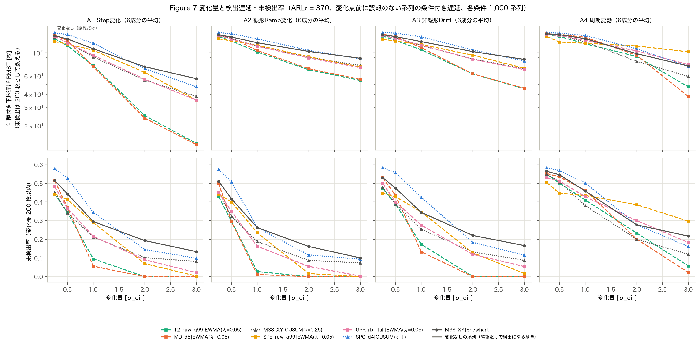

【結果】平均 RMST は、PCA T²（99%）の EWMA が 95.7 枚で最も短く、Mahalanobis（5次）の EWMA 100.0、
M3S の CUSUM 107.5、PCA SPE の EWMA 108.5、GPR 残差の EWMA 109.0 が続いた。
ベースラインの M3S（Shewhart）は 117.4、係数 SPC の最良（CUSUM）は 123.4 だった。
どの土台でも EWMA か CUSUM が Shewhart より速く、計測値を平滑化してから多変量の統計量を当てる EWMA（＝MEWMA）が上位を占めた。

## 6.1 Step 変化（A1）

| 検出器 | 0.25σ | 0.5σ | 1σ | 2σ | 3σ | 変化なし |
| :--- | ---: | ---: | ---: | ---: | ---: | ---: |
| T2_raw_q99\|EWMA(λ=0.05) | 136.79 | 116.79 | 75.57 | 25.07 | 13.59 | 152.19 |
| MD_d5\|EWMA(λ=0.05) | 148.12 | 130.62 | 73.81 | 23.70 | 13.24 | 152.16 |
| M3S_XY\|CUSUM(k=0.25) | 142.36 | 123.89 | 91.40 | 54.76 | 38.31 | 157.20 |
| SPE_raw_q99\|EWMA(λ=0.05) | 128.00 | 121.67 | 105.90 | 64.91 | 35.36 | 148.70 |
| GPR_rbf_full\|EWMA(λ=0.05) | 143.93 | 124.43 | 94.73 | 55.80 | 35.41 | 149.68 |
| M3S_XY\|EWMA-scalar(λ=0.1) | 145.78 | 128.76 | 96.01 | 59.60 | 40.49 | 157.90 |
| MD_d5\|CUSUM(k=1) | 152.92 | 130.39 | 78.82 | 38.88 | 25.67 | 159.21 |
| M3S_XY\|Shewhart | 145.85 | 135.70 | 109.26 | 73.65 | 56.56 | 153.56 |
| MD_d5\|Shewhart | 154.56 | 150.19 | 132.60 | 65.46 | 20.17 | 156.30 |
| GPR_rbf_full\|CUSUM(k=0.5) | 151.61 | 143.10 | 116.73 | 77.65 | 52.14 | 153.98 |
| T2_raw_q99\|Shewhart | 151.12 | 142.94 | 121.39 | 87.41 | 44.51 | 154.50 |
| SPC_d4\|CUSUM(k=1) | 155.55 | 149.62 | 123.33 | 70.44 | 47.38 | 156.52 |
| SPC_d4\|EWMA(λ=0.2) | 151.79 | 148.50 | 130.84 | 81.19 | 52.85 | 152.60 |
| GPR_rbf_full\|Shewhart | 153.23 | 149.38 | 132.36 | 96.23 | 67.47 | 154.44 |
| SPC_d4\|Shewhart | 153.13 | 151.48 | 142.95 | 107.04 | 70.77 | 153.25 |
| SPE_raw_q99\|Shewhart | 154.40 | 146.14 | 131.25 | 126.91 | 122.15 | 157.01 |
| T2_raw_q99\|CUSUM(k=1) | 176.53 | 159.29 | 118.60 | 68.37 | 47.42 | 190.29 |
| SPE_raw_q99\|CUSUM(k=1) | 200.00 | 200.00 | 197.68 | 182.77 | 175.63 | 200.00 |

（A1 Step変化：変化量ごとの平均 RMST 遅延 [枚]、6成分の平均。未検出は 200 枚として数える）

【結果】1σ_dir の Step 変化の RMST は、Mahalanobis の EWMA 73.8、PCA T² の EWMA 75.6 枚に対し、M3S（Shewhart）は 109.3 枚だった。
3σ_dir では EWMA の2つが 13.2・13.6 枚、M3S は 56.6 枚。局所変形の成分では PCA SPE の EWMA が特に速く、
1σ_dir の Step を中央値 5 枚で検出した（M3S は 180 枚）。

## 6.2 Ramp 変化（A2）

| 検出器 | 0.25σ | 0.5σ | 1σ | 2σ | 3σ | 変化なし |
| :--- | ---: | ---: | ---: | ---: | ---: | ---: |
| T2_raw_q99\|EWMA(λ=0.05) | 143.04 | 130.06 | 101.77 | 68.85 | 54.44 | 152.19 |
| MD_d5\|EWMA(λ=0.05) | 149.80 | 139.10 | 105.15 | 70.54 | 55.63 | 152.16 |
| M3S_XY\|CUSUM(k=0.25) | 147.71 | 136.83 | 116.68 | 90.16 | 75.75 | 157.20 |
| SPE_raw_q99\|EWMA(λ=0.05) | 136.35 | 130.12 | 118.32 | 91.69 | 73.35 | 148.70 |
| GPR_rbf_full\|EWMA(λ=0.05) | 145.80 | 135.40 | 115.51 | 89.36 | 72.13 | 149.68 |
| M3S_XY\|EWMA-scalar(λ=0.1) | 150.04 | 139.91 | 119.61 | 93.12 | 77.88 | 157.90 |
| MD_d5\|CUSUM(k=1) | 156.05 | 142.19 | 110.42 | 81.18 | 67.17 | 159.21 |
| M3S_XY\|Shewhart | 148.68 | 141.60 | 124.95 | 103.06 | 88.61 | 153.56 |
| MD_d5\|Shewhart | 155.52 | 152.78 | 140.38 | 102.51 | 77.62 | 156.30 |
| GPR_rbf_full\|CUSUM(k=0.5) | 152.01 | 146.44 | 131.66 | 106.46 | 89.40 | 153.98 |
| T2_raw_q99\|Shewhart | 152.21 | 146.45 | 134.47 | 108.42 | 85.01 | 154.50 |
| SPC_d4\|CUSUM(k=1) | 156.01 | 152.62 | 136.14 | 105.55 | 87.65 | 156.52 |
| SPC_d4\|EWMA(λ=0.2) | 152.01 | 150.25 | 139.12 | 109.91 | 91.65 | 152.60 |
| GPR_rbf_full\|Shewhart | 153.48 | 150.58 | 139.80 | 117.94 | 100.64 | 154.44 |
| SPC_d4\|Shewhart | 153.21 | 152.09 | 146.76 | 125.36 | 105.28 | 153.25 |
| SPE_raw_q99\|Shewhart | 155.54 | 149.59 | 141.55 | 134.98 | 129.54 | 157.01 |
| T2_raw_q99\|CUSUM(k=1) | 180.74 | 168.57 | 140.27 | 105.87 | 88.72 | 190.29 |
| SPE_raw_q99\|CUSUM(k=1) | 200.00 | 200.00 | 196.80 | 188.65 | 184.42 | 200.00 |

（A2 線形Ramp変化：変化量ごとの平均 RMST 遅延 [枚]、6成分の平均。未検出は 200 枚として数える）

【結果】Ramp（100 枚後に振幅 a）は Step より遅れて検出され、3σ_dir でも PCA T² の EWMA 54.4 枚、Mahalanobis の EWMA 55.6 枚、M3S（Shewhart）88.6 枚だった。
【考察】Ramp では変化が小さい初期の間は検出できず、変化が累積して正常なばらつきの数倍になったところで検出される。平滑化の強い EWMA（λ = 0.05）は小さな変化を積み上げるので有利になる。

## 6.3 非線形 Drift（A3）

【結果】飽和する Drift（1 − e^{−t/50}）の結果は Ramp とほぼ同じ順位で、3σ_dir の RMST は PCA T² の EWMA 45.3 枚、Mahalanobis の EWMA 45.7 枚、M3S（Shewhart）86.5 枚だった（変化量ごとの値は `results/metrics/phase2_delays.csv`）。

## 6.4 周期変動（A4）

【結果】周期 50 枚の正弦波は、平均すると 0 なので平滑化の効果が出にくい。3σ_dir の RMST は Mahalanobis の EWMA 38.2、Mahalanobis（Shewhart）43.6、
PCA T² の EWMA 47.2、M3S の CUSUM 59.4 枚で、PCA SPE の EWMA は 102.2 枚と遅かった。
1σ_dir では多くの検出器が変化なしの基準に近かった（例：Mahalanobis の EWMA 140.8 枚、変化なし 152.2 枚）。
【考察】周期変動は符号が入れ替わるので、小さな振幅では平滑化しても積み上がらない。SPE の EWMA が 3σ_dir でも遅かったのは、正負の変化が EWMA で打ち消され、
2乗の統計量に残りにくいためと考えられる。周期的な変動を見たい場合は、Shewhart 型を併用する必要がある。

## 6.5 変化する面内成分による違い

| 検出器 | low | high | radial | tangential | asymmetric | local |
| :--- | ---: | ---: | ---: | ---: | ---: | ---: |
| T2_raw_q99\|EWMA(λ=0.05) | 114.02 | 110.44 | 107.38 | 100.07 | 94.62 | 47.46 |
| MD_d5\|EWMA(λ=0.05) | 109.51 | 103.75 | 101.87 | 94.37 | 98.69 | 91.66 |
| M3S_XY\|CUSUM(k=0.25) | 119.62 | 155.35 | 71.46 | 90.98 | 83.34 | 124.37 |
| SPE_raw_q99\|EWMA(λ=0.05) | 133.21 | 129.75 | 124.80 | 124.38 | 110.05 | 28.51 |
| GPR_rbf_full\|EWMA(λ=0.05) | 139.30 | 104.51 | 106.04 | 104.28 | 135.94 | 64.05 |
| SPC_d4\|CUSUM(k=1) | 139.10 | 156.22 | 104.58 | 101.50 | 124.01 | 114.74 |
| M3S_XY\|Shewhart | 139.18 | 153.86 | 83.35 | 98.55 | 92.90 | 136.54 |

（成分ごとの平均 RMST 遅延 [枚]。A1〜A4・全変化量の平均）

【結果】最も速い検出器は成分によって違った。局所変形は PCA SPE の EWMA（平均 RMST 28.5 枚）、Radial・非対称・Tangential のように正常なばらつきの大きい滑らかな成分は
M3S の CUSUM（Radial 71.5 枚。PCA T² の EWMA は 107.4 枚）、低次・高次 Zernike は Mahalanobis の EWMA（低次 109.5、高次 103.8 枚）が最も速かった。
これは Phase 1 の単一 Wafer の結果（第5.3節）と同じ傾向である。

## 6.6 検出遅延と誤報率

【結果】ARL₀ は全ての検出器で校正し、独立な確認では 341〜395 だった（目標 370、付録 C.1）。変化点前（100 枚）に誤報が出た系列の割合は、
多くの検出器で 16%〜26% だった（ARL₀ = 370 なら約 24%）。
一方、高次元の多変量 CUSUM（PCA T²・Mahalanobis）とスカラーの SPE の CUSUM は、統計量が 0 から立ち上がるのに時間がかかるため、
変化点前（最初の 100 枚）の誤報がほとんどなかった（PCA T² の CUSUM：0.0%）。ARL₀ は合わせてあるので、その分の誤報はそれより後に出る。PCA SPE の CUSUM は変化をほとんど検出できなかった（平均検出率 8.3%）。
【考察】多変量 CUSUM の参照値 k を 0.25〜1 で選んだが、数百次元では正常時の統計量の大きさが次元に比例して大きくなり、k が小さすぎた（issues I-014）。
スカラーの統計量（SPE・D²）に CUSUM を当てる方法は、統計量そのものが2乗の量なので小さな平均の変化に鈍い。平均の変化を積み上げるには、
計測値（またはスコア）を先に平滑化して2乗の統計量を当てる MEWMA の形がよかった。

検出した系列だけの平均遅延（参考）は、PCA T² の EWMA 71.8 枚、M3S（Shewhart）79.9 枚で、RMST とは順位の開きが小さい。
未検出の系列を除いた平均だけで比べると、検出できなかった条件の差が見えなくなる。

## 6.7 正常工程の時系列相関 ρ の影響

ρ = 0, 0.3, 0.7, 0.95 で学習・ARL₀ の校正をし直し、本評価と同じ検出器を比べた（縮小した条件：A1・A2 × 低次・局所 × 全変化量、500 系列）。
自己相関のある工程向けの方法として、AR(1) の残差 z̃_t = (z_t − c) − φ(z_{t−1} − c) を監視する「特殊原因管理図」[alwan1988] も比べた（φ は学習データから推定。ρ = 0.95 で φ = 0.91）。

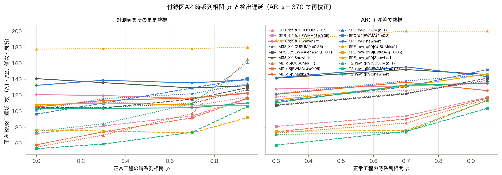

| 検出器 | 入力 | ρ = 0 | ρ = 0.3 | ρ = 0.7 | ρ = 0.95 |
| :--- | :--- | ---: | ---: | ---: | ---: |
| GPR_rbf_full\|CUSUM(k=0.5) | そのまま | 107.09 | 111.76 | 106.23 | 117.84 |
| GPR_rbf_full\|CUSUM(k=0.5) | AR(1) 残差 | — | 118.22 | 125.81 | 136.51 |
| GPR_rbf_full\|EWMA(λ=0.05) | そのまま | 72.01 | 81.56 | 94.04 | 116.31 |
| GPR_rbf_full\|EWMA(λ=0.05) | AR(1) 残差 | — | 80.92 | 94.04 | 117.45 |
| GPR_rbf_full\|Shewhart | そのまま | 120.69 | 119.52 | 115.95 | 122.97 |
| GPR_rbf_full\|Shewhart | AR(1) 残差 | — | 127.68 | 131.77 | 134.77 |
| M3S_XY\|CUSUM(k=0.25) | そのまま | 103.44 | 104.90 | 109.70 | 127.02 |
| M3S_XY\|CUSUM(k=0.25) | AR(1) 残差 | — | 107.88 | 122.46 | 138.58 |
| M3S_XY\|EWMA-scalar(λ=0.1) | そのまま | 104.57 | 103.97 | 115.03 | 129.48 |
| M3S_XY\|EWMA-scalar(λ=0.1) | AR(1) 残差 | — | 107.13 | 121.50 | 141.19 |
| M3S_XY\|Shewhart | そのまま | 140.59 | 135.64 | 129.00 | 131.76 |
| M3S_XY\|Shewhart | AR(1) 残差 | — | 141.18 | 151.96 | 145.82 |
| MD_d5\|CUSUM(k=1) | そのまま | 55.19 | 70.01 | 97.19 | 164.55 |
| MD_d5\|CUSUM(k=1) | AR(1) 残差 | — | 72.57 | 85.11 | 114.92 |
| MD_d5\|EWMA(λ=0.05) | そのまま | 58.07 | 74.17 | 91.53 | 116.06 |
| MD_d5\|EWMA(λ=0.05) | AR(1) 残差 | — | 74.39 | 90.26 | 116.33 |
| MD_d5\|Shewhart | そのまま | 105.35 | 113.32 | 116.54 | 122.18 |
| MD_d5\|Shewhart | AR(1) 残差 | — | 121.02 | 136.17 | 125.67 |
| SPC_d4\|CUSUM(k=1) | そのまま | 101.48 | 115.55 | 121.69 | 134.21 |
| SPC_d4\|CUSUM(k=1) | AR(1) 残差 | — | 121.83 | 137.78 | 145.39 |
| SPC_d4\|EWMA(λ=0.2) | そのまま | 96.34 | 110.03 | 128.89 | 140.81 |
| SPC_d4\|EWMA(λ=0.2) | AR(1) 残差 | — | 112.27 | 130.36 | 151.79 |
| SPC_d4\|Shewhart | そのまま | 132.26 | 138.57 | 135.31 | 139.14 |
| SPC_d4\|Shewhart | AR(1) 残差 | — | 141.79 | 155.30 | 143.17 |
| SPE_raw_q99\|CUSUM(k=1) | そのまま | 177.55 | 177.92 | 178.16 | 180.02 |
| SPE_raw_q99\|CUSUM(k=1) | AR(1) 残差 | — | 188.18 | 200.00 | 200.00 |
| SPE_raw_q99\|EWMA(λ=0.05) | そのまま | 76.58 | 75.11 | 72.88 | 92.01 |
| SPE_raw_q99\|EWMA(λ=0.05) | AR(1) 残差 | — | 74.95 | 75.66 | 113.57 |
| SPE_raw_q99\|Shewhart | そのまま | 107.96 | 110.22 | 107.74 | 106.64 |
| SPE_raw_q99\|Shewhart | AR(1) 残差 | — | 114.18 | 131.20 | 146.50 |
| T2_raw_q99\|CUSUM(k=1) | そのまま | 74.65 | 84.30 | 109.25 | 160.45 |
| T2_raw_q99\|CUSUM(k=1) | AR(1) 残差 | — | 70.84 | 73.88 | 113.52 |
| T2_raw_q99\|EWMA(λ=0.05) | そのまま | 53.21 | 58.90 | 73.62 | 105.72 |
| T2_raw_q99\|EWMA(λ=0.05) | AR(1) 残差 | — | 57.57 | 74.71 | 103.52 |
| T2_raw_q99\|Shewhart | そのまま | 102.86 | 103.51 | 104.23 | 110.28 |
| T2_raw_q99\|Shewhart | AR(1) 残差 | — | 110.55 | 132.57 | 134.89 |

【結果】ρ が大きくなると、EWMA の遅延は大きく延びた（PCA T² の EWMA：ρ = 0 で 53.2 枚 → ρ = 0.95 で 105.7 枚、Mahalanobis の EWMA：58.1 → 116.1 枚）。
一方、Shewhart はほとんど変わらず（PCA T²：102.9 → 110.3 枚、M3S：140.6 → 131.8 枚）、ρ = 0.95 では EWMA の利点はほとんどなくなった。
AR(1) 残差で監視すると、高次元の多変量 CUSUM は改善したが（Mahalanobis の CUSUM：ρ = 0.95 で 164.5 → 114.9 枚）、EWMA はほぼ同じ（PCA T² の EWMA 103.5 枚）で、
Shewhart は悪化した（PCA T²：134.9 枚）。
【考察】正常工程そのものがゆっくり動く（ρ が大きい）と、平滑化した統計量にも正常な変動が残り、ARL₀ をそろえるには管理限界を広げるしかない。
そのため「小さな持続的な変化を積み上げる」EWMA の強みが失われる。AR(1) 残差は持続的な変化を変化の始まりの1回の跳びに変えてしまうので、
各 Wafer を独立に判定する方法には不利になる。自己相関の強い工程では、正常な変動のモデル（ここでは AR(1)）の精度が経時変化の検知の限界を決めると考えられる。

---

# 第7章 計測条件の影響（Phase 3）

Phase 1 の系統別代表の上位3つ（PCA T²（計測値 99%）・GPR 残差・Mahalanobis 距離（5次））、ベースラインの M3S、上位3つの OR 統合（OR[top]）について、
計測点数・計測配置・計測ノイズ・監視多項式の次数を1つずつ変え（単因子スイープ）、その後に影響の大きかった2因子の組み合わせを調べた。
条件ごとに監視手法を学習し直し、管理限界も正常データ（20,000 枚）で FPR 1% に校正し直した。異常の物理的な大きさは全点・基準ノイズの σ_dir で固定した
（同じ異常を、点数やノイズを変えて測る）。各条件 1,000 回。識別できない条件（点数 − 項数 < 5、ランク不足）はなかった（25% の 80 点でも 5次多項式の自由度は 59）。

| 因子 | 水準間の検出率の幅（手法×パターンの平均） | 幅の最大（手法×パターン） | 全体の平均検出率の最小 | 全体の平均検出率の最大 |
| :--- | ---: | ---: | ---: | ---: |
| 計測ノイズ | 0.16 | 0.54 | 0.35 | 0.42 |
| 計測密度 | 0.12 | 0.64 | 0.37 | 0.42 |
| 監視多項式の次数 | 0.05 | 0.48 | 0.40 | 0.42 |
| 計測配置 | 0.02 | 0.09 | 0.36 | 0.37 |

【結果】因子の効き方（手法 × パターンごとの水準間の検出率の幅の平均）は、計測ノイズ 0.16、計測密度 0.12、
監視多項式の次数 0.05、計測配置 0.02 の順だった。一方、全パターンの平均検出率の幅は 0.06（ノイズ）・0.05（密度）と小さい。
【考察】条件を変えると、良くなるパターンと悪くなるパターンがあり、平均すると打ち消し合う。計測条件の評価は異常の種類ごとに行う必要がある。

## 7.1 計測点数

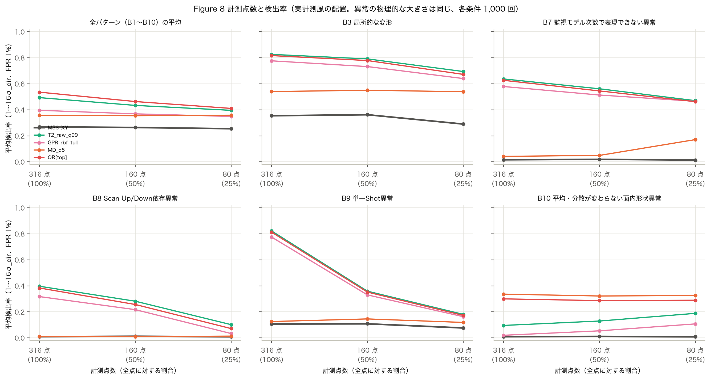

【結果】点を全点（316 点）から 25%（80 点・20 Shot）に減らすと、局所的・滑らかでない異常の検出率が大きく下がった（PCA T²（99%）：
B9 単一 Shot 0.82 → 0.18、B8 Scan 依存 0.40 → 0.10、B7 0.64 → 0.47、B3 局所 0.83 → 0.69）。
滑らかな低次の異常（B1・B2・B4〜B6）と Mahalanobis はほとんど変わらず（Mahalanobis の全パターン平均：0.36 → 0.36）、GPR 残差はむしろ上がった（B4：0.19 → 0.35）。
【考察】25% のマップは 97 Shot のうち 20 Shot しか測らないので、無作為な1 Shot の異常（B9）がそもそも測られる確率は約 2 割しかない。局所的な異常の監視には、
点の配置の工夫よりも「どれだけ多くの Shot を測るか」が効く。滑らかな異常は 80 点でも低次の係数を十分に推定できる。

## 7.2 計測配置

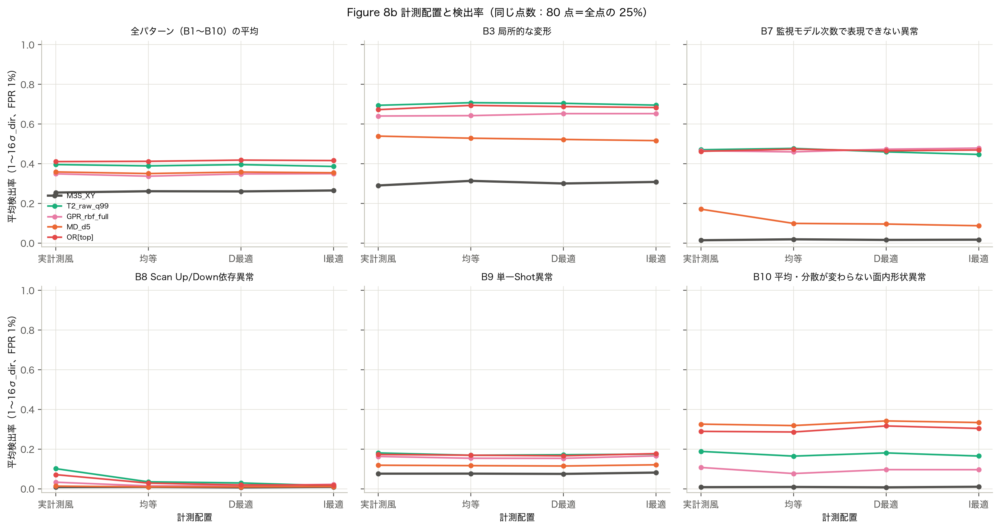

【結果】同じ 80 点で、実計測風・均等・D 最適・I 最適の配置の差は小さく、手法 × パターンごとの検出率の差は最大でも 0.09 だった（全パターン平均で 0.36〜0.37）。
【考察】D 最適・I 最適は多項式の係数や予測の精度を上げる配置だが [atkinson2007]、異常検知の検出率は「異常がある場所を測っているか」と「正常なばらつきとの比」で決まり、
配置の最適化の効果は小さかった。

## 7.3 計測ノイズ

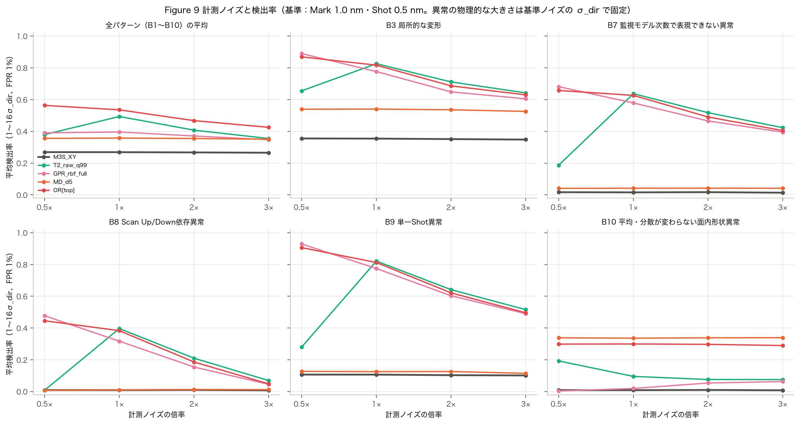

【結果】ノイズを3倍にすると、局所的・高次の異常の検出率が下がった（PCA T²（99%）：B9 0.82 → 0.52、B8 0.40 → 0.07、B7 0.64 → 0.42）。
M3S と Mahalanobis はほとんど変わらなかった（M3S の全パターン平均：0.27 → 0.27）。
ノイズを半分にすると GPR 残差は B9 で 0.93 まで上がったが、PCA T²（99%）は逆に 0.28 に下がった。
このとき寄与率 99% で選ばれた主成分の数は、基準ノイズの 311 個から 66 個に減っていた。
【考察】寄与率で主成分の数を決めると、計測誤差が小さいほど計測誤差の方向が T² の部分空間から外れ、局所的な異常は SPE の側に移る。
T² だけを使うと感度が逆に下がるので、主成分の数を固定するか、T² と SPE（または GPR 残差）を必ず組み合わせる必要がある。OR 統合の全パターン平均はノイズ 0.5 倍で 0.56 と、基準ノイズ（0.54）より高かった。

## 7.4 監視多項式の次数

【結果】Mahalanobis 距離の次数を 3 次と 5 次で比べると、B5（n = 4〜5 の Zernike）は 3 次で 0.02、5 次で 0.50、
B10 は 0.17 と 0.34 だった。一方、低次の B1・B2・B4 は 3 次の方がわずかによかった（B4：0.60 と 0.52）。
【考察】監視したい異常の形を表せる次数が必要で、足りないと検出できない。必要以上に高い次数は、係数の数が増える分だけ低次の異常の感度を少し下げる。

## 7.5 交互作用（計測密度 × 計測ノイズ）

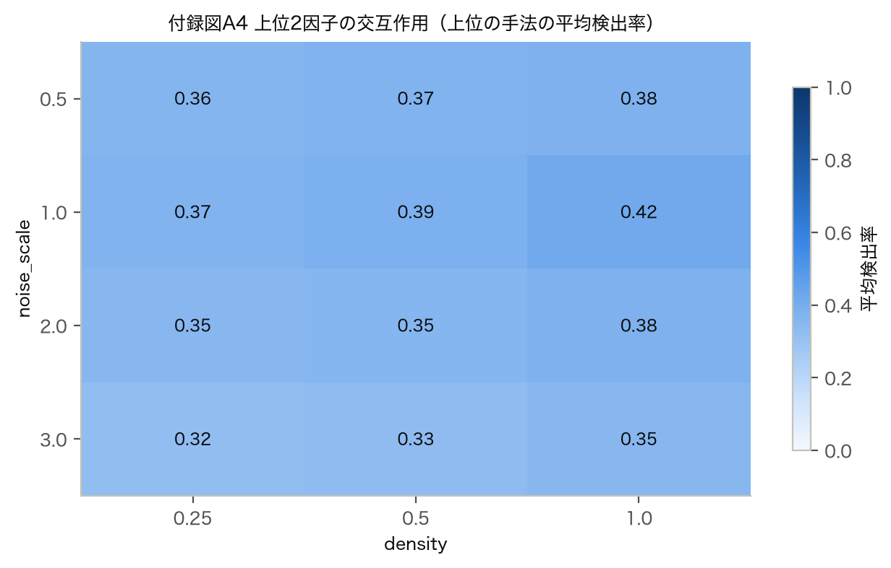

【結果】上位の手法の平均検出率は、全点・基準ノイズの 0.42 に対し、25%・ノイズ3倍で 0.32 だった。B9（単一 Shot）だけで見ると
0.57 から 0.12 まで下がり、点数とノイズの悪化が重なった。

## 7.6 経時変化検知への影響

Phase 2 の上位3つ（PCA T²・Mahalanobis・PCA SPE の EWMA）と M3S の最良（CUSUM）を、計測条件ごとに学習・ARL₀ の校正をし直して比べた
（縮小した条件：A1・A2 × 低次・局所 × 0.5・1・2σ_dir、300 系列）。

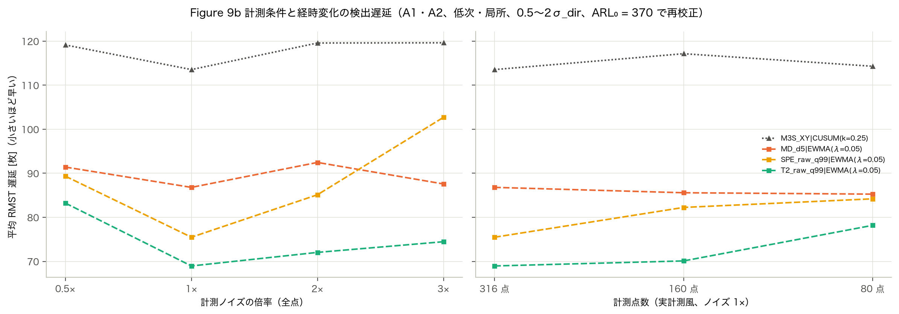

| 条件 | M3S_XY\|CUSUM(k=0.25) | MD_d3\|EWMA(λ=0.05) | MD_d4\|EWMA(λ=0.05) | MD_d5\|EWMA(λ=0.05) | SPE_raw_q99\|EWMA(λ=0.05) | T2_raw_q99\|EWMA(λ=0.05) |
| :--- | ---: | ---: | ---: | ---: | ---: | ---: |
| 密度 100%・実計測風・ノイズ 1×・各手法の次数 | 113.55 | — | — | 86.80 | 75.49 | 68.96 |
| 密度 50%・実計測風・ノイズ 1×・各手法の次数 | 117.16 | — | — | 85.59 | 82.25 | 70.10 |
| 密度 25%・実計測風・ノイズ 1×・各手法の次数 | 114.30 | — | — | 85.27 | 84.20 | 78.18 |
| 密度 25%・均等・ノイズ 1×・各手法の次数 | 113.47 | — | — | 85.77 | 86.48 | 72.25 |
| 密度 25%・D最適・ノイズ 1×・各手法の次数 | 125.75 | — | — | 85.40 | 83.91 | 73.48 |
| 密度 25%・I最適・ノイズ 1×・各手法の次数 | 114.32 | — | — | 89.87 | 85.21 | 74.63 |
| 密度 100%・実計測風・ノイズ 0.5×・各手法の次数 | 119.14 | — | — | 91.41 | 89.34 | 83.23 |
| 密度 100%・実計測風・ノイズ 2×・各手法の次数 | 119.59 | — | — | 92.47 | 85.13 | 72.04 |
| 密度 100%・実計測風・ノイズ 3×・各手法の次数 | 119.63 | — | — | 87.58 | 102.71 | 74.47 |
| 密度 100%・実計測風・ノイズ 1×・3次 | 116.49 | 106.15 | — | — | 75.55 | 72.28 |
| 密度 100%・実計測風・ノイズ 1×・4次 | 114.99 | — | 101.02 | — | 84.03 | 69.68 |

（平均 RMST 遅延 [枚]。多項式の次数を変えた条件は Mahalanobis だけが変わる。次数 5 は基準と同じなので省略）

【結果】経時変化の検知は、1 Wafer の検知より計測条件の影響が小さかった。PCA T² の EWMA は全点 69.0 枚に対し、25% で 78.2 枚、ノイズ3倍で 74.5 枚だった。
ただし局所成分では、PCA SPE の EWMA がノイズ3倍で 22.6 → 64.4 枚と遅くなった。ノイズを半分にすると PCA T² の EWMA は 83.2 枚と逆に遅くなり、
1 Wafer の検知と同じく主成分の数の変化（第7.3節）の影響が見られた。
【考察】EWMA は複数の Wafer を平均するので、点数の不足や計測誤差の増加をある程度補える。1 Wafer の監視より経時変化の監視の方が、計測の間引きに強いと考えられる。

---

# 第8章 APC 補正による異常検知への影響

## 8.1 条件

Wafer ごとの補正を理想化したモデルで調べた。Alignment（80 点＝20 Shot × 4 マーク、実計測風の配置）に d_c 次の多項式を当てはめ、
その補正量を、別の **Overlay 検証点**（200 点＝均等に選んだ 40 Shot × 5 点）で差し引いた残差を補正後の Overlay とした
（補正の学習点と評価点を分ける。仕様の r_t = y_t − Xβ̂_t を、Alignment と Overlay が別の情報源であることを反映して書き直したもの）。
補正次数は d_c = 1（線形の6パラメータ）・3・5 次。「ノイズを過学習する条件」として、Alignment を 40 点（10 Shot）・計測誤差3倍にした条件も比べた。

| シナリオ | 内容 | 補正で除去できるか |
|---|---|---|
| S1_linear | X 方向だけの倍率（1次） | d_c ≥ 1 で除去 |
| S2_cubic_radial | 3次の放射状歪み（B1 と同じ形） | d_c ≥ 3 で除去 |
| S3_zernike89・S3_local・S3_single_shot | n = 8〜9 の Zernike・局所変形・単一 Shot | どの次数でも残る |
| S4_alignment_flyer | Alignment の1マークだけの計測外れ値（実際のずれはない） | 補正が外れ値に引っ張られる |

監視対象は、(1) 補正前の Alignment 計測値、(2) 推定した補正係数（Mahalanobis 距離・係数 SPC）、(3) 補正後の Overlay 残差の3つ。
すべて正常データで FPR 1% に校正した。「真の Overlay 残差 RMS」は計測誤差を含まない残差（真のずれ − 補正量）の大きさで、実際の重ね合わせへの影響を表す。

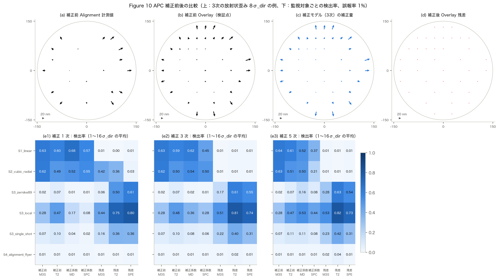

**標準の条件（Alignment 80 点、検出率は 1〜16σ_dir の平均）**

| 補正次数 | シナリオ | 補正前 M3S | 補正前 T2 | 補正前 SPE | 補正係数 MD | 補正係数 SPC | 残差 M3S | 残差 T2 | 残差 SPE | 真の Overlay 残差 RMS [nm] |
| ---: | :--- | ---: | ---: | ---: | ---: | ---: | ---: | ---: | ---: | ---: |
| 1 | S1_linear | 0.63 | 0.60 | 0.13 | 0.68 | 0.57 | 0.01 | 0.00 | 0.01 | 5.69 |
| 1 | S2_cubic_radial | 0.62 | 0.49 | 0.06 | 0.52 | 0.55 | 0.42 | 0.36 | 0.03 | 9.74 |
| 1 | S3_local | 0.28 | 0.47 | 0.67 | 0.17 | 0.08 | 0.44 | 0.75 | 0.80 | 10.28 |
| 1 | S3_single_shot | 0.07 | 0.10 | 0.15 | 0.04 | 0.02 | 0.16 | 0.36 | 0.36 | 6.94 |
| 1 | S3_zernike89 | 0.02 | 0.07 | 0.45 | 0.01 | 0.01 | 0.06 | 0.50 | 0.61 | 6.37 |
| 1 | S4_alignment_flyer | 0.01 | 0.01 | 0.18 | 0.01 | 0.01 | 0.01 | 0.01 | 0.01 | 5.70 |
| 3 | S1_linear | 0.63 | 0.59 | 0.15 | 0.62 | 0.45 | 0.01 | 0.01 | 0.01 | 3.51 |
| 3 | S2_cubic_radial | 0.62 | 0.50 | 0.05 | 0.54 | 0.50 | 0.01 | 0.01 | 0.01 | 3.51 |
| 3 | S3_local | 0.28 | 0.48 | 0.66 | 0.36 | 0.28 | 0.51 | 0.81 | 0.74 | 8.22 |
| 3 | S3_single_shot | 0.07 | 0.10 | 0.15 | 0.08 | 0.06 | 0.22 | 0.40 | 0.31 | 5.21 |
| 3 | S3_zernike89 | 0.02 | 0.07 | 0.44 | 0.02 | 0.01 | 0.17 | 0.61 | 0.55 | 4.54 |
| 3 | S4_alignment_flyer | 0.01 | 0.01 | 0.17 | 0.01 | 0.01 | 0.01 | 0.02 | 0.01 | 3.53 |
| 5 | S1_linear | 0.64 | 0.61 | 0.21 | 0.52 | 0.37 | 0.01 | 0.01 | 0.01 | 3.00 |
| 5 | S2_cubic_radial | 0.63 | 0.51 | 0.06 | 0.50 | 0.21 | 0.01 | 0.01 | 0.01 | 3.00 |
| 5 | S3_local | 0.28 | 0.47 | 0.66 | 0.53 | 0.44 | 0.53 | 0.82 | 0.73 | 8.57 |
| 5 | S3_single_shot | 0.07 | 0.11 | 0.15 | 0.11 | 0.08 | 0.23 | 0.42 | 0.31 | 5.06 |
| 5 | S3_zernike89 | 0.02 | 0.07 | 0.44 | 0.16 | 0.08 | 0.28 | 0.63 | 0.54 | 4.90 |
| 5 | S4_alignment_flyer | 0.01 | 0.01 | 0.18 | 0.01 | 0.01 | 0.02 | 0.04 | 0.01 | 3.11 |

## 8.2 補正前の Alignment

【結果】補正前の Alignment の M3S・PCA T² は、補正次数によらず S1・S2 を検出した（S1：M3S 63.4%、S2：62.5%）。
S3 の局所変形は Alignment の SPE で 66.5% 検出できたが、点数が少ないため補正後の Overlay 残差（SPE 74.1%）より弱かった。

## 8.3 補正係数

【結果】補正係数の Mahalanobis 距離は、補正で除去される異常（S1・S2）をよく検出した（3次補正で S1 61.9%、S2 54.0%）。
補正では表現できない異常（S3）でも、補正次数が高いほど係数に漏れ込んで検出率が上がった（局所変形：1次 17.5% → 5次 52.6%）。

## 8.4 補正後 Overlay 残差と異常の隠蔽

【結果】補正後の Overlay 残差だけを監視すると、補正で除去される異常は見えなくなった。S1 は全ての補正次数・振幅で残差の M3S の検出率が 1.1% 以下（正常時の誤報と同じ。線形の異常は補正で完全に消える）、
S2 は 1次補正では 41.9% 検出できたが、3次補正では 0.6% に下がった。このとき真の Overlay 残差 RMS は
正常時と同じ 3.53 nm（3次補正）で、その Wafer の重ね合わせには影響がなかった。
一方、補正で表現できない S3 は残差に残り、残差の PCA T²・SPE で検出できた（3次補正の局所変形：T² 80.8%、SPE 74.1%）。
【考察】補正後の残差は「今の Wafer の重ね合わせが悪いか」を見る指標で、補正で吸収できる工程変化（倍率・高次の歪みの増加）は見えない。
補正量が大きくなり続けると、いずれ補正の範囲を超えたり、補正の次数を下げた工程で問題になる可能性がある。工程変化の監視には、補正係数か補正前の Alignment を併用する必要がある。

## 8.5 ノイズを過学習する条件

**Alignment 40 点・計測誤差3倍（検出率は 1〜16σ_dir の平均）**

| 補正次数 | シナリオ | 補正前 M3S | 補正前 T2 | 補正前 SPE | 補正係数 MD | 補正係数 SPC | 残差 M3S | 残差 T2 | 残差 SPE | 真の Overlay 残差 RMS [nm] |
| ---: | :--- | ---: | ---: | ---: | ---: | ---: | ---: | ---: | ---: | ---: |
| 1 | S1_linear | 0.58 | 0.50 | 0.03 | 0.62 | 0.55 | 0.01 | 0.00 | 0.01 | 5.92 |
| 1 | S2_cubic_radial | 0.62 | 0.47 | 0.02 | 0.51 | 0.55 | 0.43 | 0.36 | 0.02 | 9.94 |
| 1 | S3_local | 0.23 | 0.40 | 0.29 | 0.16 | 0.10 | 0.46 | 0.71 | 0.82 | 10.64 |
| 1 | S3_single_shot | 0.05 | 0.06 | 0.03 | 0.04 | 0.03 | 0.17 | 0.30 | 0.36 | 7.24 |
| 1 | S3_zernike89 | 0.02 | 0.20 | 0.14 | 0.01 | 0.02 | 0.07 | 0.46 | 0.62 | 6.62 |
| 1 | S4_alignment_flyer | 0.01 | 0.03 | 0.05 | 0.01 | 0.01 | 0.01 | 0.00 | 0.01 | 5.94 |
| 3 | S1_linear | 0.58 | 0.52 | 0.02 | 0.56 | 0.38 | 0.01 | 0.01 | 0.01 | 5.27 |
| 3 | S2_cubic_radial | 0.62 | 0.47 | 0.02 | 0.52 | 0.44 | 0.01 | 0.01 | 0.01 | 5.27 |
| 3 | S3_local | 0.23 | 0.40 | 0.29 | 0.28 | 0.24 | 0.45 | 0.76 | 0.80 | 10.34 |
| 3 | S3_single_shot | 0.05 | 0.07 | 0.03 | 0.05 | 0.05 | 0.18 | 0.36 | 0.33 | 6.94 |
| 3 | S3_zernike89 | 0.02 | 0.19 | 0.13 | 0.07 | 0.05 | 0.16 | 0.53 | 0.61 | 6.56 |
| 3 | S4_alignment_flyer | 0.02 | 0.04 | 0.05 | 0.01 | 0.01 | 0.02 | 0.01 | 0.01 | 5.38 |
| 5 | S1_linear | 0.57 | 0.51 | 0.03 | 0.42 | 0.24 | 0.01 | 0.01 | 0.01 | 10.33 |
| 5 | S2_cubic_radial | 0.61 | 0.47 | 0.01 | 0.46 | 0.06 | 0.01 | 0.01 | 0.01 | 10.33 |
| 5 | S3_local | 0.23 | 0.40 | 0.28 | 0.40 | 0.33 | 0.25 | 0.44 | 0.65 | 17.04 |
| 5 | S3_single_shot | 0.06 | 0.06 | 0.03 | 0.06 | 0.05 | 0.05 | 0.17 | 0.29 | 11.64 |
| 5 | S3_zernike89 | 0.02 | 0.19 | 0.13 | 0.18 | 0.08 | 0.08 | 0.23 | 0.44 | 12.60 |
| 5 | S4_alignment_flyer | 0.02 | 0.03 | 0.04 | 0.03 | 0.02 | 0.03 | 0.04 | 0.02 | 10.82 |

【結果】点数が少なく誤差の大きい Alignment に 5次の補正をすると、正常時の真の Overlay 残差 RMS は 10.21 nm となり、
3次補正の 5.27 nm の約2倍になった（標準の条件の 5次補正は 2.99 nm）。
この条件では残差のばらつきが大きくなり、補正後残差の監視の感度が下がった（局所変形の検出率：残差 PCA T² が 3次 75.9% → 5次 43.6%、
残差 M3S が 44.8% → 25.1%）。
Alignment の1マークの外れ値（S4）は、標準の条件では 16σ_dir（約 18 nm）でも 5次補正の真の Overlay 残差 RMS を 2.99 nm から 3.41 nm に増やす程度で、
監視ではほとんど検出されなかった（1〜16σ_dir の平均で最も高い Alignment の SPE でも 17.6%）。
【考察】高次の補正は「補正に使う点の数と誤差」に見合った次数でないと、計測誤差を補正量に取り込み、重ね合わせそのものを悪くする。
これは異常検知の面でも、正常時の残差のばらつきを大きくして他の異常を隠す方向に働く。

## 8.6 経時変化（Ramp）の隠蔽

Wafer ごとの 3次補正の下で、A2 Ramp（低次・Radial・局所の3成分、0.5〜2σ_dir、300 系列）を監視した。各監視対象に Shewhart と EWMA（λ = 0.1）を当て、ARL₀ = 370 に校正した。

| 監視対象・検出器 | 低次（補正で除去） | Radial（補正で除去） | 局所（補正で残る） |
| :--- | ---: | ---: | ---: |
| 補正前 M3S\|EWMA-scalar(λ=0.1) | 127.82 | 80.46 | 126.77 |
| 補正前 M3S\|Shewhart | 138.60 | 95.13 | 136.90 |
| 補正前 MD_d5\|EWMA(λ=0.1) | 113.10 | 102.11 | 80.93 |
| 補正前 MD_d5\|Shewhart | 131.95 | 122.06 | 103.96 |
| 補正前 SPE\|EWMA(λ=0.1) | 152.65 | 148.62 | 73.54 |
| 補正前 SPE\|Shewhart | 155.90 | 155.40 | 96.12 |
| 補正前 T2\|EWMA(λ=0.1) | 107.79 | 96.63 | 93.17 |
| 補正前 T2\|Shewhart | 127.72 | 116.69 | 115.97 |
| 補正係数 MD\|EWMA(λ=0.1) | 111.23 | 101.51 | 123.62 |
| 補正係数 MD\|Shewhart | 129.75 | 118.90 | 137.99 |
| 補正係数 SPC\|EWMA(λ=0.1) | 117.51 | 112.26 | 129.42 |
| 補正係数 SPC\|Shewhart | 135.41 | 129.72 | 141.54 |
| 残差 M3S\|EWMA-scalar(λ=0.1) | 141.22 | 141.22 | 106.62 |
| 残差 M3S\|Shewhart | 151.43 | 151.43 | 131.68 |
| 残差 MD_d5\|EWMA(λ=0.1) | 148.22 | 148.22 | 83.31 |
| 残差 MD_d5\|Shewhart | 143.03 | 143.03 | 100.31 |
| 残差 SPE\|EWMA(λ=0.1) | 142.10 | 142.10 | 45.60 |
| 残差 SPE\|Shewhart | 162.06 | 162.06 | 96.47 |
| 残差 T2\|EWMA(λ=0.1) | 142.46 | 142.46 | 47.90 |
| 残差 T2\|Shewhart | 150.48 | 150.48 | 73.18 |

（成分ごとの平均 RMST 遅延 [枚]、0.5〜2σ_dir の平均。変化なしの系列の RMST は 136〜162 枚）

【結果】補正で除去できる低次・Radial の Ramp は、補正後の Overlay 残差では変化なしと同じ程度の RMST（例：低次の残差 T² の EWMA 142 枚）にとどまり、事実上検出できなかった（低次と Radial で残差の値がまったく同じなのは、どちらも補正で完全に除去され、残差が同じ正常系列そのものになるため）。
同じ変化を、補正前の Alignment の PCA T²（EWMA）は 108 枚、補正係数の Mahalanobis（EWMA）は 111 枚で検出した。
補正で除去できない局所変形の Ramp は、補正後の残差の SPE（EWMA）が 46 枚で最も速く、補正係数の Mahalanobis（EWMA）は 124 枚と遅かった。
【考察】補正後の Overlay 残差だけを監視すると、補正で吸収される経時変化（倍率・高次の歪みのドリフト）は、補正量が増え続けていても見えない。
補正係数（補正量）の経時変化と補正後の残差を両方監視すれば、「補正で追従できている変化」と「補正で取り切れない変化」を区別できる。

---

# 第9章 考察

## 9.1 手法の適用範囲

本研究の結果（第5〜8章）から、監視の目的と異常の種類ごとに次の組み合わせを推奨する。推奨は事前の想定ではなく、同じ誤報率での比較結果に基づく。

| 監視の目的・異常の種類 | 推奨する手法 | 根拠（本研究の結果） | 注意 |
|---|---|---|---|
| 単一 Wafer：正常な大きい変動と同じ向きの滑らかな異常（倍率・回転・Radial・非対称） | M3S（今の管理を残す）、Mahalanobis（低次） | B1・B2・B4 で M3S の 50% 検出振幅 2.7〜3.1σ_dir（第5.3節） | 形の情報は持たない |
| 単一 Wafer：係数の組み合わせ・平均と分散が同じ形の異常（B5・B6・B10） | Mahalanobis 距離（縮小推定、異常を表せる次数） | B10 を 8σ_dir で 90.4%（4次）検出、M3S は誤報率と同じ（第5.2節） | 次数が足りないと検出できない（第7.4節） |
| 単一 Wafer：局所・単一 Shot・高次・Scan 依存（B3・B7・B8・B9） | 計測値の PCA T²（高い寄与率）、PCA SPE、GPR 残差 | B9 の 50% 検出振幅 1.3σ_dir（T²）、B7 は SPE が最良（第5.3節） | 計測する Shot の数が効く（第7.1節） |
| 単一 Wafer：種類を限定しない監視 | M3S・Mahalanobis・PCA T²・SPE・GPR 残差の OR 統合（統合後の誤報率で校正） | 平均検出率 56.7%（全手法で最高、第5.1節） | 組み合わせは Phase 1 の結果から決めた。下側の異常には別の判定が必要 |
| 経時変化：微小なドリフト全般 | 計測値の EWMA（λ = 0.05）＋ PCA T² または Mahalanobis（MEWMA） | 平均 RMST 95.7・100.0 枚（第6章） | 周期的な変動には弱い |
| 経時変化：局所的な変化 | PCA SPE の EWMA | 局所の平均 RMST 28.5 枚 | 滑らかな変化には遅い |
| 経時変化：大きな滑らかな成分（Radial・非対称） | M3S の CUSUM | Radial の平均 RMST 71.5 枚 | 局所・高次は不可 |
| APC 補正の下での監視 | 補正係数（または補正前 Alignment）と補正後残差の両方 | 補正で除去できる異常は残差では誤報率並み（第8章） | 補正次数は Alignment の点数・誤差に合わせる |

## 9.2 異常検知の限界

- **原理的に見分けにくい異常**：正常な Wafer の分布とほとんど同じ形になる変化（例：180°回転。正常な分布がほぼ対称なため）は、どの手法でも検出できなかった（第5.2節）。
  M3S が同一になる異常でも、形の分布が正常と重なれば、空間情報を使っても見つからない。
- **計測誤差に近い大きさの細かい異常**：Scan 依存（B8）のように、正常なばらつきの小さい方向に乗る異常は、σ_dir 単位では大きくても nm では小さく（4σ_dir で RMS 0.44 nm）、
  計測誤差と区別するには多くの点が要る。点を 25% にすると検出率は 0.40 から 0.10 に下がった。
- **微小な経時変化**：0.25〜0.5σ_dir の変化は、200 枚の間では変化なしの基準とあまり変わらなかった（第6章の表）。
- **下側の異常**：計測値を無作為に入れ替えた Wafer のように「普段より滑らか（係数が小さい）」異常は、上側の管理限界だけでは見逃す。
- **監視の設定による落とし穴**：PCA の主成分数を寄与率で決めるとノイズの大きさで性質が変わる（第7.3節）。高次元の多変量 CUSUM は参照値 k を次元に合わせないと感度が低い（第6.6節）。
- **大きさの基準について**：σ_dir は「その向きの正常なばらつき」の単位なので、同じ振幅でも nm の大きさはパターンで大きく違う（第2.3節の表）。
  実工程で許容できる nm の大きさに読み替えて判断する必要がある。

## 9.3 実工程への適用

- **学習データ**：正常モデル（平均・共分散・主成分・GPR の超パラメータ）は時系列順の正常データで学習する。工程・装置・計測マップが変わったら学習し直す。
  PCA と GPR は計測点の並びに依存するため、マップを変えたら作り直す必要がある。
- **管理限界**：本研究では 50,000 枚の正常データで経験的に校正したが、実工程でこれだけの正常データを集めるのは難しい。
  理論上の限界は Mahalanobis（χ²）や係数 SPC（Bonferroni）では目標に近かったが、SPE（Box の近似）や寄与率 99% の T² は大きくずれた（第4.9節）。
  少ないデータで運用するなら、誤報率を 1% 程度にし、ずれやすい統計量は経験的に校正する、ブートストラップで限界の不確かさを確かめる、などの工夫が要る。
- **解釈性**：係数 SPC は「どの係数が動いたか」を直接読めるが、係数どうしの相関を使えず検出力は低かった。Mahalanobis や PCA T² で警報を出し、
  原因の確認には係数 SPC や係数ごとの寄与を見る二段構えがよい。GPR 残差は「どの Shot・Mark が滑らかな傾向から外れたか」を地図で示せる。
- **計算負荷**：本研究の手法はすべて計測値の線形変換と2次形式なので、計測点が固定なら行列を先に作り、1 Wafer の計算は 1 ミリ秒未満で済む。
  GPR も固定マップでは事前計算で軽くなる。マップが Wafer ごとに変わる場合は誘導点法などが必要になる。
- **APC との関係**：補正後の Overlay 残差の監視は「今の Wafer の品質」を、補正係数・補正前 Alignment の監視は「工程の変化」を見る。両方を並べて監視する。

## 9.4 今後の課題

- 実データ（複数ロット・複数装置）での検証（正常モデルの学習と誤報率の確認）。
- ロット間の R2R フィードバック APC の下での経時変化の見え方（本研究は Wafer ごとの補正）。
- 下側の異常の監視、多変量 CUSUM の参照値を次元に合わせる方法、主成分数を固定した PCA の比較。
- ロット内の Wafer 間の相関、Chuck による違い、Shot 内（Intra-field）の成分の扱い。
- 本研究では対象外とした空間自己相関（相関距離のある計測誤差）の影響。

---

# 第10章 結論

模擬データ（Zernike 7次までの正常な面内傾向、AR(1) の時系列、Shot・Mark の階層的な計測誤差）で、8つの監視手法を同じ誤報率にそろえて比べ、次の結論を得た。

**RQ1 M3S では見逃す Wafer 面内形状異常に対して、どの監視手法が最も有効か。**
M3S の検出率が 10% 未満だった7パターン（局所・高次・係数の組み合わせ・表現できない高次・Scan 依存・単一 Shot・平均と分散が同じ形）では、
計測値の PCA T²（寄与率 99%）が平均検出率 52.0% で最も有効だった（M3S は 13.5%）。ただし最良の手法は異常の種類で違い、
平均と標準偏差が同じ滑らかな形の変化（B10）では Mahalanobis 距離（4次で 8σ_dir の検出率 90.4%）が、局所・単一 Shot・高次では PCA T²・SPE・GPR 残差が最もよかった。

**RQ2 微小な Wafer 面内傾向の経時変化を最も早く検知できる手法は何か。**
計測値を EWMA（λ = 0.05）で平滑化してから PCA T²（または Mahalanobis 距離）を当てる方法（MEWMA）が、平均 RMST 95.7 枚（Mahalanobis 100.0 枚）で最も早かった
（M3S の Shewhart は 117.4 枚）。局所的な変化では PCA SPE の EWMA（28.5 枚）、Radial などの大きな滑らかな成分では M3S の CUSUM（71.5 枚）が最も早かった。
ただし正常工程の時系列相関が強いと（ρ = 0.95）EWMA の利点は小さくなり（PCA T² の EWMA 105.7 枚、Shewhart 110.3 枚）、AR(1) 残差で監視しても EWMA は改善しなかった。

**RQ3 異常パターンによって有効な監視手法はどの程度異なるか。**
大きく異なる。振幅 4σ_dir では、同じパターンでも手法によって検出率がほぼ 0 から 100% まで分かれ（例：B9 は PCA T² で 100%、M3S で約 2%）、
最良の手法は「正常な大きい変動と同じ向きの滑らかな異常＝M3S」「係数の組み合わせの異常＝Mahalanobis」「滑らかでない・局所的な異常＝PCA T²・SPE・GPR」の3群に分かれた。
経時変化でも、変化する成分によって最も早い検出器が違った。

**RQ4 計測点数や計測ノイズによって監視性能はどの程度低下するか。**
滑らかな低次の異常にはほとんど影響しなかったが、局所的・滑らかでない異常では大きく低下した。全点（316 点）から 25%（80 点）にすると単一 Shot の異常の検出率は
0.82 → 0.18、ノイズを3倍にすると 0.82 → 0.52 になった（PCA T²）。同じ点数での配置（実計測風・均等・D 最適・I 最適）の差は小さかった（最大 0.09）。
寄与率で主成分数を決める PCA はノイズの大きさで主成分数が 66〜557 個と変わり、性能が単調でなかった。

**RQ5 APC 補正後の Overlay のみを監視した場合、どのような異常を見逃すか。**
補正モデルで表せる異常を見逃す。線形の異常は全ての補正次数で、3次の放射状歪みは 3次以上の補正で、補正後の残差の検出率が誤報率並み（0.6%）になった。
これらの異常の経時変化（Ramp）も残差では見えず、補正係数と補正前 Alignment の監視でだけ検出できた。また、点数の少ない Alignment に高次の補正をすると、
計測誤差を補正に取り込んで残差が大きくなり（正常時の真の残差 RMS 5.27 → 10.21 nm）、他の異常の検出も鈍くなった。

**RQ6 単一の監視手法で十分か。それとも複数の監視手法を組み合わせる必要があるか。**
単一の手法では不十分で、組み合わせが必要である。1 Wafer の異常では、得意な異常の違う5指標（M3S・Mahalanobis・PCA T²・SPE・GPR 残差）を OR で統合（統合後の誤報率で校正）した検出器が、
全手法で最も高い平均検出率（56.7%。単独の最良は PCA T² の 49.9%）を示した。
経時変化には単発の異常に強い Shewhart 型と、小さな持続的変化に強い EWMA（MEWMA）を併用し、APC の下では補正係数と補正後残差を両方監視する。
推奨する構成は、(1) 1 Wafer の判定：M3S・Mahalanobis・PCA T²・SPE・GPR 残差の OR 統合（独立なデータ・実データでの確認は今後の課題）、(2) 経時変化：計測値の EWMA（λ = 0.05）による MEWMA と SPE の EWMA、
(3) APC：補正係数の Mahalanobis（EWMA）と補正後残差の監視、である。

---

# 謝辞

本研究の実行指示（研究課題・評価条件・品質保証項目の設計）を作成した依頼者に感謝する。数値計算には NumPy・SciPy・pandas・scikit-learn・Matplotlib などのオープンソースソフトウェアを用いた。

---

# 参考文献

本文中の [id] は次の文献を指す（書誌情報は Crossref などで実在を確認した。一覧の正本は `references/references.json`）。

- [page1954] Page, E. S. (1954). Continuous inspection schemes. Biometrika, 41(1-2), 100-115. https://doi.org/10.1093/biomet/41.1-2.100
- [roberts1959] Roberts, S. W. (1959). Control chart tests based on geometric moving averages. Technometrics, 1(3), 239-250. https://doi.org/10.1080/00401706.1959.10489860
- [lucas1990] Lucas, J. M.; Saccucci, M. S. (1990). Exponentially weighted moving average control schemes: properties and enhancements. Technometrics, 32(1), 1-12. https://doi.org/10.1080/00401706.1990.10484583
- [lowry1992] Lowry, C. A.; Woodall, W. H.; Champ, C. W.; Rigdon, S. E. (1992). A multivariate exponentially weighted moving average control chart. Technometrics, 34(1), 46-53. https://doi.org/10.1080/00401706.1992.10485232
- [crosier1988] Crosier, R. B. (1988). Multivariate generalizations of cumulative sum quality-control schemes. Technometrics, 30(3), 291-303. https://doi.org/10.1080/00401706.1988.10488402
- [jackson1979] Jackson, J. E.; Mudholkar, G. S. (1979). Control procedures for residuals associated with principal component analysis. Technometrics, 21(3), 341-349. https://doi.org/10.1080/00401706.1979.10489779
- [box1954] Box, G. E. P. (1954). Some theorems on quadratic forms applied in the study of analysis of variance problems, I. The Annals of Mathematical Statistics, 25(2), 290-302. https://doi.org/10.1214/aoms/1177728786
- [macgregor1995] MacGregor, J. F.; Kourti, T. (1995). Statistical process control of multivariate processes. Control Engineering Practice, 3(3), 403-414. https://doi.org/10.1016/0967-0661(95)00014-L
- [qin2003] Qin, S. J. (2003). Statistical process monitoring: basics and beyond. Journal of Chemometrics, 17(8-9), 480-502. https://doi.org/10.1002/cem.800
- [ledoit2004] Ledoit, O.; Wolf, M. (2004). A well-conditioned estimator for large-dimensional covariance matrices. Journal of Multivariate Analysis, 88(2), 365-411. https://doi.org/10.1016/S0047-259X(03)00096-4
- [alwan1988] Alwan, L. C.; Roberts, H. V. (1988). Time-series modeling for statistical process control. Journal of Business & Economic Statistics, 6(1), 87-95. https://doi.org/10.1080/07350015.1988.10509640
- [woodall2004] Woodall, W. H.; Spitzner, D. J.; Montgomery, D. C.; Gupta, S. (2004). Using control charts to monitor process and product quality profiles. Journal of Quality Technology, 36(3), 309-320. https://doi.org/10.1080/00224065.2004.11980276
- [colosimo2010] Colosimo, B. M.; Pacella, M. (2010). A comparison study of control charts for statistical monitoring of functional data. International Journal of Production Research, 48(6), 1575-1601. https://doi.org/10.1080/00207540802662888
- [rasmussen2006] Rasmussen, C. E.; Williams, C. K. I. (2006). Gaussian Processes for Machine Learning. MIT Press（ISBN 026218253X）. https://doi.org/10.7551/mitpress/3206.001.0001
- [noll1976] Noll, R. J. (1976). Zernike polynomials and atmospheric turbulence. Journal of the Optical Society of America, 66(3), 207-211. https://doi.org/10.1364/JOSA.66.000207
- [hanley1982] Hanley, J. A.; McNeil, B. J. (1982). The meaning and use of the area under a receiver operating characteristic (ROC) curve. Radiology, 143(1), 29-36. https://doi.org/10.1148/radiology.143.1.7063747
- [wilson1927] Wilson, E. B. (1927). Probable inference, the law of succession, and statistical inference. Journal of the American Statistical Association, 22(158), 209-212. https://doi.org/10.1080/01621459.1927.10502953
- [montgomery2001] Montgomery, D. C. (2001). Introduction to Statistical Quality Control (4th ed.). John Wiley & Sons（ISBN 0-471-31648-2）.
- [atkinson2007] Atkinson, A. C.; Donev, A. N.; Tobias, R. D. (2007). Optimum Experimental Designs, with SAS. Oxford University Press.
- [adel2007] Adel, M.; Izikson, P.; Tien, D.; Huang, C. K.; Robinson, J. C.; Eichelberger, B. (2007). The challenges of transitioning from linear to high-order overlay control in advanced lithography. Proc. SPIE 6827 (Quantum Optics, Optical Data Storage, and Advanced Microlithography), 682722. https://doi.org/10.1117/12.778457
- [pike2012] Pike, M.; Felix, N.; Menon, V.; Ausschnitt, C.; Wiltshire, T.; Meyers, S.; Kim, W.; Minghetti, B. (2012). High-order wafer alignment in manufacturing. Proc. SPIE 8324 (Metrology, Inspection, and Process Control for Microlithography XXVI), 832408. https://doi.org/10.1117/12.916483

---

# Appendix

## A. 異常 Wafer のサンプル

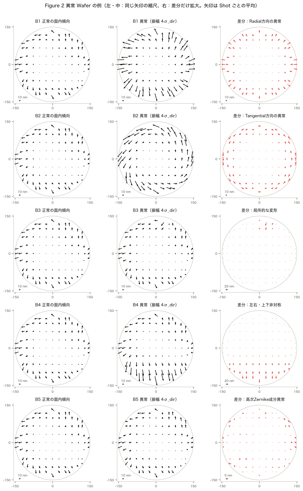

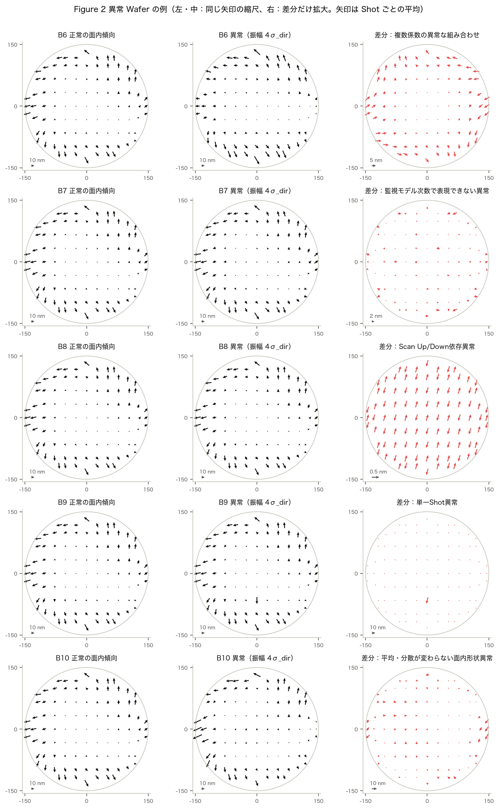

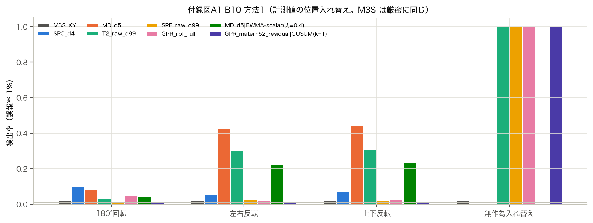

## B. 全評価条件

| 段階 | 内容 | 規模 |
| :--- | :--- | :--- |
| Phase 1 | 1 Wafer の異常（B1〜B10） | 学習 3,000 枚・校正 50,000・評価 50,000・異常は各条件 1,000 回、振幅 [1, 2, 4, 8, 16]、FPR [0.05, 0.01, 0.001] |
| Phase 2 予備 | λ・k の選定 | 200 系列 × 300 枚、ARL₀ 校正 400 本 × 3000 枚 |
| Phase 2 本評価 | 経時変化（A1〜A4 × 6成分） | 1,000 系列 × 300 枚、振幅 [0.25, 0.5, 1.0, 2.0, 3.0]、ARL₀ = 370（校正 1000 本・確認 1000 本 × 3000 枚） |
| Phase 2 ρ | 時系列相関 | ρ = [0.0, 0.3, 0.7, 0.95]、['A1', 'A2'] × ['low', 'local']、500 系列 |
| Phase 3 | 計測条件（単因子＋上位2因子の交互作用） | 密度 [1.0, 0.5, 0.25]、配置 ['realistic', 'uniform', 'd_optimal', 'i_optimal']（25%）、ノイズ [0.5, 1.0, 2.0, 3.0]、次数 [3, 4, 5]、各条件 1,000 回 |
| Phase 3 時系列 | 経時変化（縮小版） | ['A1', 'A2'] × ['low', 'local'] × [0.5, 1.0, 2.0]、300 系列 |
| APC | 補正による隠蔽 | 補正次数 [1, 3, 5]、Alignment 25%（標準）・12.5%＋ノイズ 3.0×（過学習条件）、各条件 1,000 回 |

- 乱数の種は 20261013。正常 Wafer・異常のパラメータ・正常系列は「種＋用途のキー」から作り、手法・振幅によらず同じものを使う（`src/config.py` の make_rng）。
- 学習データは時系列順の正常系列（ρ = 0.7 の AR(1)）。校正・評価・異常のデータとは別の乱数列。
- 設定ファイル：`configs/default.yaml`（本報告）、`configs/quick_test.yaml`（動作確認）、`configs/full_experiment.yaml`（より大きな評価）。

## C. 詳細な性能比較表

**C.1 経時変化：ARL₀ の校正と独立な確認（Phase 2 本評価）**

| 検出器 | 管理限界 | ARL₀（校正） | ARL₀（独立な確認） | 95%CI 下限 | 95%CI 上限 | 打ち切り本数 |
| :--- | ---: | ---: | ---: | ---: | ---: | ---: |
| M3S_XY\|Shewhart | 3.65 | 370.06 | 340.58 | 319.21 | 361.94 | 0 |
| M3S_XY\|EWMA-scalar(λ=0.1) | 1.00 | 370.71 | 358.14 | 337.00 | 379.27 | 0 |
| M3S_XY\|CUSUM(k=0.25) | 16.20 | 370.96 | 355.63 | 334.38 | 376.88 | 1 |
| SPC_d4\|Shewhart | 3.86 | 370.00 | 349.68 | 326.64 | 372.73 | 1 |
| SPC_d4\|EWMA(λ=0.2) | 2.27 | 370.10 | 341.53 | 321.47 | 361.59 | 0 |
| SPC_d4\|CUSUM(k=1) | 16.13 | 370.16 | 367.79 | 345.37 | 390.20 | 0 |
| T2_raw_q99\|Shewhart | 345.95 | 370.48 | 394.57 | 371.87 | 417.27 | 0 |
| T2_raw_q99\|EWMA(λ=0.05) | 19.54 | 370.61 | 384.33 | 363.97 | 404.70 | 0 |
| T2_raw_q99\|CUSUM(k=1) | 296.12 | 370.02 | 373.39 | 367.25 | 379.53 | 0 |
| GPR_rbf_full\|Shewhart | 780.98 | 370.30 | 367.32 | 344.85 | 389.80 | 0 |
| GPR_rbf_full\|EWMA(λ=0.05) | 39.20 | 370.54 | 369.91 | 348.50 | 391.32 | 0 |
| GPR_rbf_full\|CUSUM(k=0.5) | 7.66 | 370.70 | 384.38 | 361.70 | 407.06 | 0 |
| MD_d5\|Shewhart | 70.55 | 370.48 | 373.16 | 350.21 | 396.11 | 2 |
| MD_d5\|EWMA(λ=0.05) | 7.90 | 371.15 | 382.05 | 360.80 | 403.31 | 0 |
| MD_d5\|CUSUM(k=1) | 126.98 | 370.00 | 389.82 | 375.44 | 404.19 | 0 |
| SPE_raw_q99\|Shewhart | 437.21 | 370.71 | 351.94 | 329.98 | 373.90 | 0 |
| SPE_raw_q99\|EWMA(λ=0.05) | 12.11 | 370.67 | 372.87 | 352.21 | 393.53 | 0 |
| SPE_raw_q99\|CUSUM(k=1) | 2059.14 | 370.00 | 369.67 | 369.32 | 370.01 | 0 |

**C.2 経時変化：成分ごとの平均 RMST 遅延 [枚]（A1〜A4・全変化量の平均）**

| 検出器 | low | high | radial | tangential | asymmetric | local |
| :--- | ---: | ---: | ---: | ---: | ---: | ---: |
| T2_raw_q99\|EWMA(λ=0.05) | 114.02 | 110.44 | 107.38 | 100.07 | 94.62 | 47.46 |
| MD_d5\|EWMA(λ=0.05) | 109.51 | 103.75 | 101.87 | 94.37 | 98.69 | 91.66 |
| M3S_XY\|CUSUM(k=0.25) | 119.62 | 155.35 | 71.46 | 90.98 | 83.34 | 124.37 |
| SPE_raw_q99\|EWMA(λ=0.05) | 133.21 | 129.75 | 124.80 | 124.38 | 110.05 | 28.51 |
| GPR_rbf_full\|EWMA(λ=0.05) | 139.30 | 104.51 | 106.04 | 104.28 | 135.94 | 64.05 |
| M3S_XY\|EWMA-scalar(λ=0.1) | 125.82 | 156.82 | 73.77 | 93.23 | 85.71 | 129.05 |
| MD_d5\|CUSUM(k=1) | 121.81 | 117.80 | 117.58 | 109.84 | 111.72 | 107.29 |
| M3S_XY\|Shewhart | 139.18 | 153.86 | 83.35 | 98.55 | 92.90 | 136.54 |
| MD_d5\|Shewhart | 129.18 | 123.08 | 120.53 | 114.37 | 120.06 | 109.67 |
| GPR_rbf_full\|CUSUM(k=0.5) | 148.78 | 115.99 | 117.20 | 116.58 | 147.13 | 74.95 |
| T2_raw_q99\|Shewhart | 139.69 | 136.10 | 132.47 | 127.26 | 121.51 | 70.54 |
| SPC_d4\|CUSUM(k=1) | 139.10 | 156.22 | 104.58 | 101.50 | 124.01 | 114.74 |
| SPC_d4\|EWMA(λ=0.2) | 140.29 | 152.08 | 107.05 | 104.43 | 126.91 | 115.63 |
| GPR_rbf_full\|Shewhart | 151.73 | 126.70 | 128.94 | 128.34 | 151.36 | 88.57 |
| SPC_d4\|Shewhart | 146.92 | 153.02 | 118.74 | 116.41 | 140.04 | 128.06 |
| SPE_raw_q99\|Shewhart | 155.50 | 155.76 | 154.80 | 154.76 | 151.44 | 67.72 |
| T2_raw_q99\|CUSUM(k=1) | 159.46 | 156.13 | 154.34 | 148.29 | 144.01 | 91.09 |
| SPE_raw_q99\|CUSUM(k=1) | 200.00 | 200.00 | 200.00 | 200.00 | 200.00 | 161.47 |

**C.3 経時変化：検出率 90% に達する最小の変化量**

| 検出器 | A1 | A2 | A3 | A4 |
| :--- | ---: | ---: | ---: | ---: |
| T2_raw_q99\|EWMA(λ=0.05) | 1.05 | 0.83 | 1.34 | 2.42 |
| MD_d5\|EWMA(λ=0.05) | 0.89 | 0.81 | 1.19 | 2.51 |
| M3S_XY\|CUSUM(k=0.25) | 0.85 | 0.78 | 1.12 | 1.57 |
| SPE_raw_q99\|EWMA(λ=0.05) | 1.79 | 1.58 | 2.17 | 0.40 |
| GPR_rbf_full\|EWMA(λ=0.05) | 1.13 | 0.87 | 1.44 | 2.76 |
| M3S_XY\|EWMA-scalar(λ=0.1) | 0.90 | 0.81 | 1.28 | 1.61 |
| MD_d5\|CUSUM(k=1) | 0.73 | 0.67 | 0.84 | — |
| M3S_XY\|Shewhart | 0.94 | 0.93 | 1.35 | 1.78 |
| MD_d5\|Shewhart | 1.89 | 1.62 | 2.41 | 2.54 |
| GPR_rbf_full\|CUSUM(k=0.5) | 1.71 | 1.50 | 2.07 | 2.43 |
| T2_raw_q99\|Shewhart | 2.35 | 1.81 | 2.50 | 2.67 |
| SPC_d4\|CUSUM(k=1) | 1.56 | 1.29 | 1.67 | 2.07 |
| SPC_d4\|EWMA(λ=0.2) | 1.63 | 1.49 | 1.83 | 1.88 |
| GPR_rbf_full\|Shewhart | 2.28 | 1.74 | 2.69 | 2.20 |
| SPC_d4\|Shewhart | 2.12 | 1.71 | 2.38 | 2.54 |
| SPE_raw_q99\|Shewhart | 0.66 | 0.43 | 0.80 | 0.81 |
| T2_raw_q99\|CUSUM(k=1) | 0.88 | 0.85 | 1.16 | 2.31 |
| SPE_raw_q99\|CUSUM(k=1) | 0.93 | 0.93 | 1.86 | 1.87 |

（200 枚以内の検出率が 90% に達する最小の変化量 [σ_dir]。6成分の中央値。「—」は 3σ_dir でも届かない成分が半数以上）

**C.4 時系列相関 ρ と平均 RMST 遅延 [枚]（A1・A2、低次・局所、全変化量の平均）**

| 検出器 | 入力 | ρ = 0 | ρ = 0.3 | ρ = 0.7 | ρ = 0.95 |
| :--- | :--- | ---: | ---: | ---: | ---: |
| GPR_rbf_full\|CUSUM(k=0.5) | そのまま | 107.09 | 111.76 | 106.23 | 117.84 |
| GPR_rbf_full\|CUSUM(k=0.5) | AR(1) 残差 | — | 118.22 | 125.81 | 136.51 |
| GPR_rbf_full\|EWMA(λ=0.05) | そのまま | 72.01 | 81.56 | 94.04 | 116.31 |
| GPR_rbf_full\|EWMA(λ=0.05) | AR(1) 残差 | — | 80.92 | 94.04 | 117.45 |
| GPR_rbf_full\|Shewhart | そのまま | 120.69 | 119.52 | 115.95 | 122.97 |
| GPR_rbf_full\|Shewhart | AR(1) 残差 | — | 127.68 | 131.77 | 134.77 |
| M3S_XY\|CUSUM(k=0.25) | そのまま | 103.44 | 104.90 | 109.70 | 127.02 |
| M3S_XY\|CUSUM(k=0.25) | AR(1) 残差 | — | 107.88 | 122.46 | 138.58 |
| M3S_XY\|EWMA-scalar(λ=0.1) | そのまま | 104.57 | 103.97 | 115.03 | 129.48 |
| M3S_XY\|EWMA-scalar(λ=0.1) | AR(1) 残差 | — | 107.13 | 121.50 | 141.19 |
| M3S_XY\|Shewhart | そのまま | 140.59 | 135.64 | 129.00 | 131.76 |
| M3S_XY\|Shewhart | AR(1) 残差 | — | 141.18 | 151.96 | 145.82 |
| MD_d5\|CUSUM(k=1) | そのまま | 55.19 | 70.01 | 97.19 | 164.55 |
| MD_d5\|CUSUM(k=1) | AR(1) 残差 | — | 72.57 | 85.11 | 114.92 |
| MD_d5\|EWMA(λ=0.05) | そのまま | 58.07 | 74.17 | 91.53 | 116.06 |
| MD_d5\|EWMA(λ=0.05) | AR(1) 残差 | — | 74.39 | 90.26 | 116.33 |
| MD_d5\|Shewhart | そのまま | 105.35 | 113.32 | 116.54 | 122.18 |
| MD_d5\|Shewhart | AR(1) 残差 | — | 121.02 | 136.17 | 125.67 |
| SPC_d4\|CUSUM(k=1) | そのまま | 101.48 | 115.55 | 121.69 | 134.21 |
| SPC_d4\|CUSUM(k=1) | AR(1) 残差 | — | 121.83 | 137.78 | 145.39 |
| SPC_d4\|EWMA(λ=0.2) | そのまま | 96.34 | 110.03 | 128.89 | 140.81 |
| SPC_d4\|EWMA(λ=0.2) | AR(1) 残差 | — | 112.27 | 130.36 | 151.79 |
| SPC_d4\|Shewhart | そのまま | 132.26 | 138.57 | 135.31 | 139.14 |
| SPC_d4\|Shewhart | AR(1) 残差 | — | 141.79 | 155.30 | 143.17 |
| SPE_raw_q99\|CUSUM(k=1) | そのまま | 177.55 | 177.92 | 178.16 | 180.02 |
| SPE_raw_q99\|CUSUM(k=1) | AR(1) 残差 | — | 188.18 | 200.00 | 200.00 |
| SPE_raw_q99\|EWMA(λ=0.05) | そのまま | 76.58 | 75.11 | 72.88 | 92.01 |
| SPE_raw_q99\|EWMA(λ=0.05) | AR(1) 残差 | — | 74.95 | 75.66 | 113.57 |
| SPE_raw_q99\|Shewhart | そのまま | 107.96 | 110.22 | 107.74 | 106.64 |
| SPE_raw_q99\|Shewhart | AR(1) 残差 | — | 114.18 | 131.20 | 146.50 |
| T2_raw_q99\|CUSUM(k=1) | そのまま | 74.65 | 84.30 | 109.25 | 160.45 |
| T2_raw_q99\|CUSUM(k=1) | AR(1) 残差 | — | 70.84 | 73.88 | 113.52 |
| T2_raw_q99\|EWMA(λ=0.05) | そのまま | 53.21 | 58.90 | 73.62 | 105.72 |
| T2_raw_q99\|EWMA(λ=0.05) | AR(1) 残差 | — | 57.57 | 74.71 | 103.52 |
| T2_raw_q99\|Shewhart | そのまま | 102.86 | 103.51 | 104.23 | 110.28 |
| T2_raw_q99\|Shewhart | AR(1) 残差 | — | 110.55 | 132.57 | 134.89 |

**C.5 計測条件ごとの平均検出率（Phase 3、B1〜B10・1〜16σ_dir、FPR 1%）**

| 条件 | 点数 | GPR_rbf_full | M3S_XY | MD_d5 | OR[top] | T2_raw_q99 |
| :--- | ---: | ---: | ---: | ---: | ---: | ---: |
| 密度 100%・実計測風・ノイズ 1×・各手法の次数 | 316 | 0.40 | 0.27 | 0.36 | 0.54 | 0.49 |
| 密度 50%・実計測風・ノイズ 1×・各手法の次数 | 160 | 0.37 | 0.26 | 0.35 | 0.46 | 0.43 |
| 密度 25%・実計測風・ノイズ 1×・各手法の次数 | 80 | 0.35 | 0.25 | 0.36 | 0.41 | 0.40 |
| 密度 25%・均等・ノイズ 1×・各手法の次数 | 80 | 0.34 | 0.26 | 0.35 | 0.41 | 0.39 |
| 密度 25%・D最適・ノイズ 1×・各手法の次数 | 80 | 0.35 | 0.26 | 0.36 | 0.42 | 0.40 |
| 密度 25%・I最適・ノイズ 1×・各手法の次数 | 80 | 0.35 | 0.26 | 0.35 | 0.42 | 0.39 |
| 密度 100%・実計測風・ノイズ 0.5×・各手法の次数 | 316 | 0.39 | 0.27 | 0.36 | 0.56 | 0.38 |
| 密度 100%・実計測風・ノイズ 2×・各手法の次数 | 316 | 0.37 | 0.27 | 0.35 | 0.47 | 0.41 |
| 密度 100%・実計測風・ノイズ 3×・各手法の次数 | 316 | 0.35 | 0.27 | 0.35 | 0.43 | 0.35 |
| 密度 100%・実計測風・ノイズ 1×・3次 | 316 | 0.40 | 0.27 | 0.29 | 0.54 | 0.50 |
| 密度 100%・実計測風・ノイズ 1×・4次 | 316 | 0.39 | 0.27 | 0.35 | 0.55 | 0.50 |
| 密度 100%・実計測風・ノイズ 1×・5次 | 316 | 0.39 | 0.27 | 0.36 | 0.53 | 0.50 |
| 密度 50%・実計測風・ノイズ 0.5×・各手法の次数 | 160 | — | — | — | — | — |
| 密度 25%・実計測風・ノイズ 0.5×・各手法の次数 | 80 | — | — | — | — | — |
| 密度 50%・実計測風・ノイズ 2×・各手法の次数 | 160 | — | — | — | — | — |
| 密度 25%・実計測風・ノイズ 2×・各手法の次数 | 80 | — | — | — | — | — |
| 密度 50%・実計測風・ノイズ 3×・各手法の次数 | 160 | — | — | — | — | — |
| 密度 25%・実計測風・ノイズ 3×・各手法の次数 | 80 | — | — | — | — | — |

**C.6 計測条件ごとの経時変化の平均 RMST 遅延 [枚]（Phase 3）**

| 条件 | M3S_XY\|CUSUM(k=0.25) | MD_d3\|EWMA(λ=0.05) | MD_d4\|EWMA(λ=0.05) | MD_d5\|EWMA(λ=0.05) | SPE_raw_q99\|EWMA(λ=0.05) | T2_raw_q99\|EWMA(λ=0.05) |
| :--- | ---: | ---: | ---: | ---: | ---: | ---: |
| 密度 100%・実計測風・ノイズ 1×・各手法の次数 | 113.55 | — | — | 86.80 | 75.49 | 68.96 |
| 密度 50%・実計測風・ノイズ 1×・各手法の次数 | 117.16 | — | — | 85.59 | 82.25 | 70.10 |
| 密度 25%・実計測風・ノイズ 1×・各手法の次数 | 114.30 | — | — | 85.27 | 84.20 | 78.18 |
| 密度 25%・均等・ノイズ 1×・各手法の次数 | 113.47 | — | — | 85.77 | 86.48 | 72.25 |
| 密度 25%・D最適・ノイズ 1×・各手法の次数 | 125.75 | — | — | 85.40 | 83.91 | 73.48 |
| 密度 25%・I最適・ノイズ 1×・各手法の次数 | 114.32 | — | — | 89.87 | 85.21 | 74.63 |
| 密度 100%・実計測風・ノイズ 0.5×・各手法の次数 | 119.14 | — | — | 91.41 | 89.34 | 83.23 |
| 密度 100%・実計測風・ノイズ 2×・各手法の次数 | 119.59 | — | — | 92.47 | 85.13 | 72.04 |
| 密度 100%・実計測風・ノイズ 3×・各手法の次数 | 119.63 | — | — | 87.58 | 102.71 | 74.47 |
| 密度 100%・実計測風・ノイズ 1×・3次 | 116.49 | 106.15 | — | — | 75.55 | 72.28 |
| 密度 100%・実計測風・ノイズ 1×・4次 | 114.99 | — | 101.02 | — | 84.03 | 69.68 |

## D. 追加図表

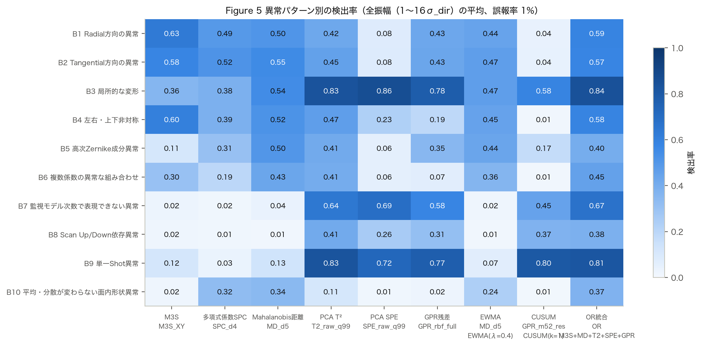

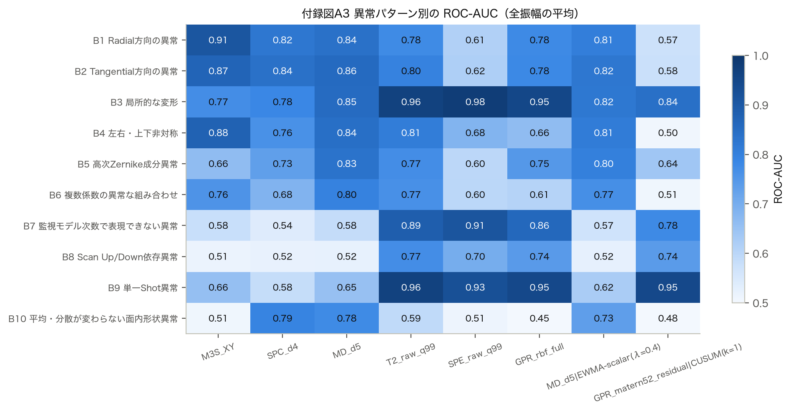

ROC-AUC・PR-AUC の全値と 95% 信頼区間は `results/metrics/phase1_auc.csv`、全検出器・全条件の検出率は `phase1_detection.csv` にある。

## E. 実装条件

- Python 3.14.6、NumPy 2.5.4、SciPy 1.18.1、pandas 3.0.6、scikit-learn 1.9.1、Matplotlib 3.11.2、seaborn 0.13.2、PyYAML 6.0.3、pyarrow 26.0.0、joblib 1.6.0、pytest 9.1.1。
- 計算機：Apple M1（8 コア）、メモリ 8 GB、6 並列。
- 計算時間（目安）：合計 約70分（Phase 1 約4分、Phase 2 約50分〔予備評価 8分・本評価 19分・ρ の比較 約24分〕、Phase 3 約10分、APC 約4分。M1・6 並列のログから。途中結果を再利用すると短くなる）。
- ユニットテスト：品質保証の15項目を `tests/` に実装（Zernike の正規化、座標の整合、再現性、異常注入の差分、B10 の平均・標準偏差・M3S の一致、正常データでの FPR、Mahalanobis の数値安定性、T²・SPE、EWMA・CUSUM の更新式、異常発生と検出の時刻、打ち切り、共通データ、データ分割、APC の学習点と検証点の分離、レポートと CSV の一致）。
- 監視手法の学習結果（主成分の数・縮小の強さ・GPR の超パラメータ）は第4章の表と `results/metrics/phase1_monitor_info.csv`。

